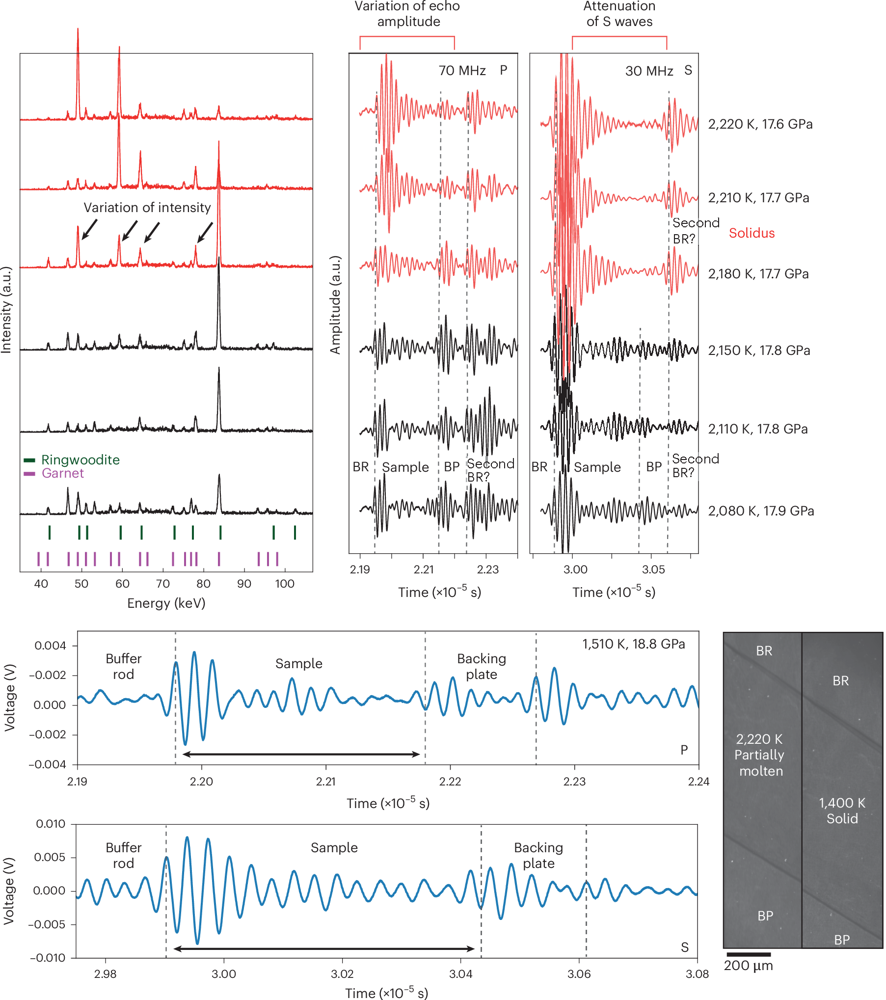
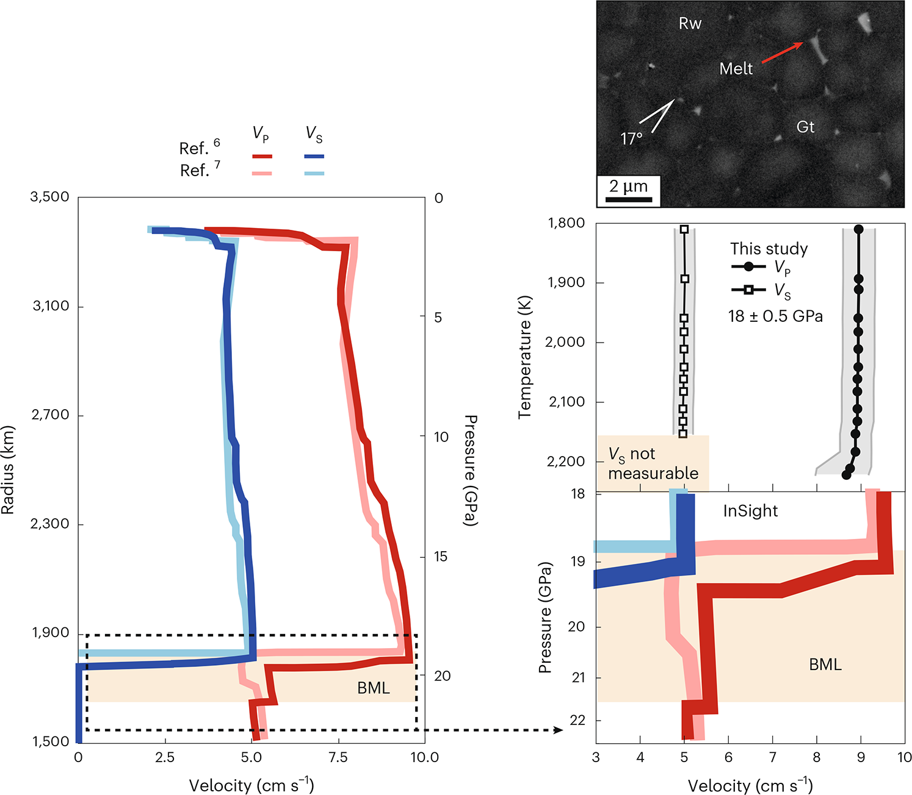
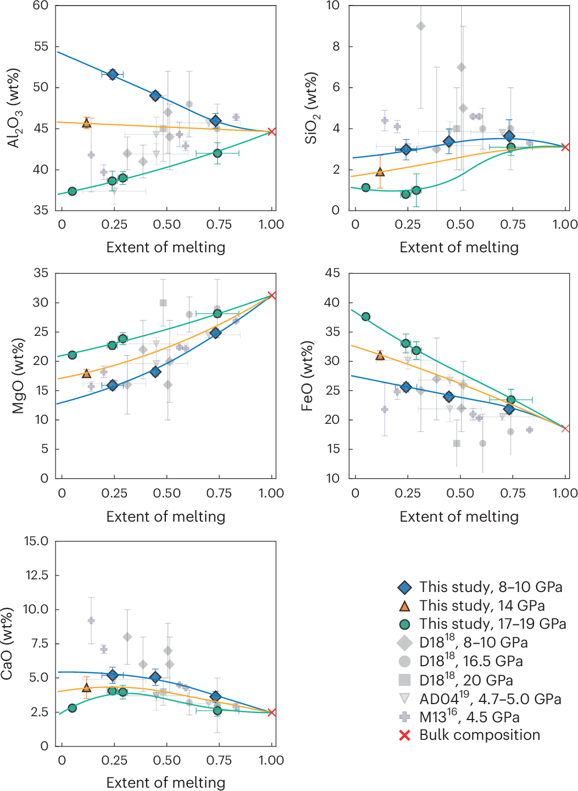
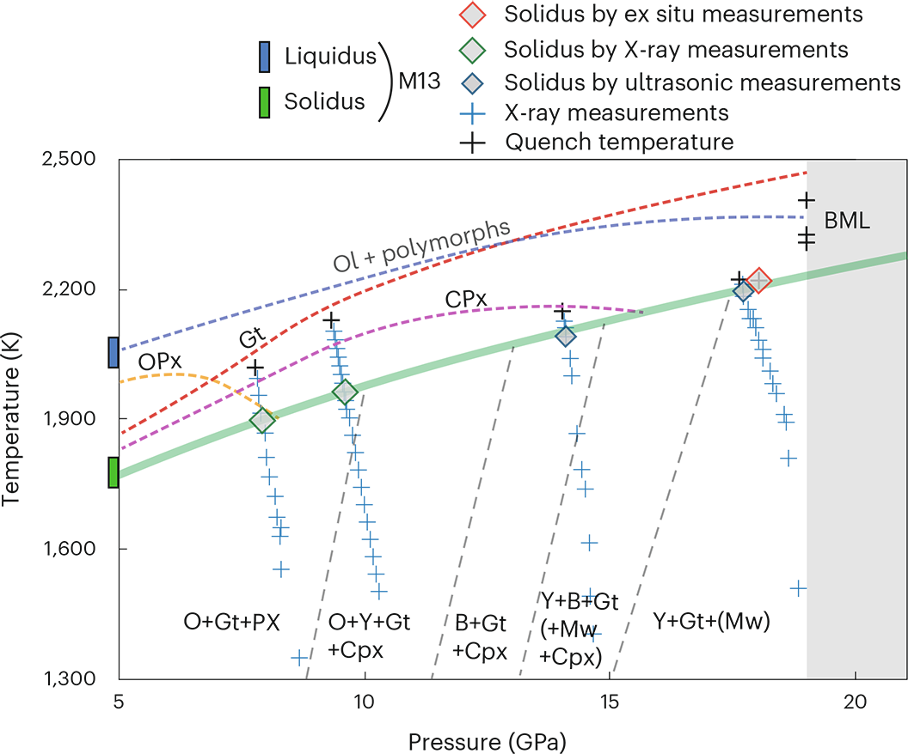
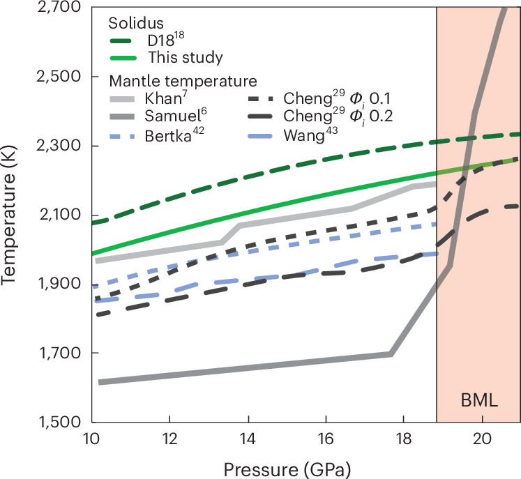
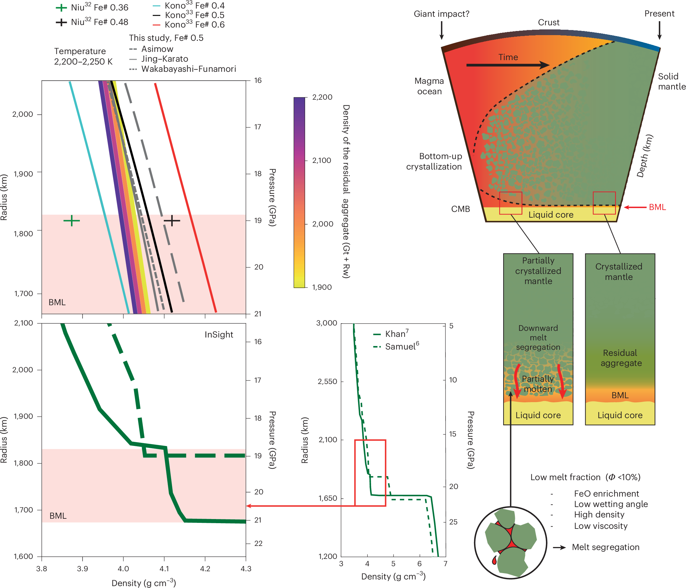

# 火星核幔边界的长期岩浆层：实验约束与“基底岩浆洋”假说
## Experimental constraints on a long-lived magma layer at the Martian core–mantle boundary

> **一句话结论**
>
> 在 18–19 GPa、约 2200 K 条件下，含约 18 wt% FeO 的火星地幔发生低程度熔融，即可产生 Fe#≈0.5、密度约 4.1 g cm⁻³、润湿角约 20° 的富铁熔体；这类熔体能够沿颗粒边界连通、向下聚集，为 InSight 推断的约 150 km 厚 CMB 低速层提供了一条不依赖“极端富铁储库翻转”的矿物物理路径。但论文证明的是**该层可以形成**，并未证明今日火星存在全球性基底岩浆洋，也没有直接测定其寿命。

---

## 0. 文献定位

- **研究类型**：高压实验岩石学 + 矿物物理 + 熔体/固体密度热力学计算。
- **研究对象与尺度**：火星地幔类比成分（约 18 wt% FeO），压力 4–19 GPa、温度约 1400–2400 K，重点对应约 1550 km 深的火星最下地幔与核幔边界（CMB）；讨论的岩浆层厚度约 150–180 km。
- **在领域中的位置**：直接回应 InSight 在火星 CMB 上方发现的低地震波速异常，检验“该异常是长期存在的富铁硅酸盐熔体层”这一解释；与 Samuel et al. (2023)、Khan et al. (2023) 的观测反演，Duncan et al. (2018) 的旧固相线，Elkins-Tanton et al. (2003) 的岩浆洋分异/翻转模型，以及 Cheng et al. (2025)、Kono et al. (2025)、Niu et al. (2026) 的热演化与熔体物性工作直接对话。
- **本文与证据包**：全文来自开放获取 PDF（`input_pdfs/s41561-026-02104-z.pdf`）；正文与图注从 PDF 提取。浏览器/CDP 路径因 `net::ERR_CONNECTION_CLOSED` 不可用，6 幅主图改由出版社 CDN 以 HTTPS 下载（图件来源记为 `http`），Extended Data 图由 PDF 裁切（`pdf`）。因此本笔记的图件不是浏览器抓取结果，但为出版社原始高分辨率图，而非 PDF 页面截图。

> **术语边界：BML ≠ 全球 BMO**
>
> 论文使用 **basal magma layer（BML）** 指 CMB 上方约 150 km 的低速熔融层；**basal magma ocean（BMO）** 通常指更厚、全球规模的底部岩浆洋。本文证明 BML 可由低程度熔融产生，并给出岩浆洋结晶残余形成 BML 的概念路径，但不能据此断言今日火星仍存在一个全球性 BMO。

### 0.1 相关文献脉络

| 时间 | 工作 | 与本文的关系 |
| :--- | :--- | :--- |
| 2003 | Elkins-Tanton et al., *Meteorit. Planet. Sci.* | 提出岩浆洋分离结晶与堆晶翻转可形成富铁底部层，是本文“极端富铁储库”对照模型。 |
| 2018 | Duncan et al., *Geophys. Res. Lett.* | 给出延伸到 25 GPa 的火星地幔固相线；本文将其作为“旧固相线”基准。 |
| 2019 | Zeff & Williams, *Geophys. Res. Lett.* | 用分离结晶解释火星底部热化学边界层。 |
| 2023 | Samuel et al., *Nature*；Khan et al., *Nature* | 基于 InSight 地震数据提出 CMB 上方存在富铁熔融硅酸盐层。 |
| 2025 | Cheng et al., *J. Geophys. Res. Planets* | 模拟长期 BMO 对火星热化学演化的影响，提供本文对照的热剖面。 |
| 2025 | Kono et al., *Commun. Earth Environ.* | 实验约束富铁橄榄岩熔体在火星 CMB 的重力稳定性。 |
| 2026 | Niu et al., *J. Geophys. Res. Planets* | 计算富铁硅酸盐熔体的黏度与热导率，支撑“低黏度、可分离”的推断。 |
| 2026 | Russell et al., *Icarus*；Samuel et al. 回复 | 对“火星底部熔融层”证据与可行性提出质疑及辩护。 |
| 2026 | Liu et al., *Earth Planet. Sci. Lett.* | 从耦合核幔演化角度模拟长期 BMO；本文不讨论其模型细节，可对照阅读。 |
| 2026 | **本文** | 用原位高压实验约束 BML 的固相线、熔体成分、润湿角与密度，检验“中等 FeO 地幔能否自行产生富铁底部熔体”。 |

---

## 1. 科学问题与假说

InSight 地震数据在火星 CMB 上方约 150 km 范围内给出异常低的波速，最直接的解译是一层熔融或部分熔融的硅酸盐（第 1 页）。但这层熔体是否真实存在、在什么 P–T 条件下形成、熔体是否足够重而不会被带走、以及它是“近期熔融”还是“岩浆洋残留”，此前都缺乏深部实验约束（第 1–2 页）。

作者没有给出编号假说，但可以把论文的可检验命题还原为四条：

1. 火星地幔固相线比 Duncan et al. (2018) 的估计更低，因而 CMB 附近在现有热剖面下更容易发生低程度熔融；
2. 低程度熔体在高压下强烈富铁，密度可与周围固体相当或更高，从而具有中性至负浮力；
3. 低润湿角使少量熔体即可形成连通网络，发生向下分离并在 CMB 上方聚集；
4. 上述过程不需要先形成一个“极端富铁”的原始储库，也不需要大规模堆晶翻转。

> **关键前提**
>
> 1. **成分代表性**：实验采用约 18 wt% FeO 的火星地幔类比成分（Taylor 2013；Bertka & Fei 1997），对应“中等 FeO”火星地幔，而非极端富铁端元（第 3 页）。
> 2. **平衡与尺度**：熔体成分、熔体分数和密度对比建立在实验尺度（毫米级样品、小时级加热）与局部平衡假设上；能否外推到 150–180 km 厚的全球层，取决于熔体分离与混合效率（第 7 页）。
> 3. **氧化还原**：实验在 Mo 箔/胶囊环境中进行，回收样品出现金属 Fe⁰，指示氧逸度接近或低于 IW 缓冲（第 9–10 页）；这与 CMB 附近被富铁核缓冲的还原条件相符，但更氧化条件下的行为未被直接测定。
> 4. **观测解释**：InSight 低速层仍存在非熔融解释（如地幔散射或成分异常），本文的讨论以“该层为熔融层”为工作假设（第 6 页）。

---

## 2. 数据与方法

### 2.1 数据 / 样品

- **起始成分**：约 18 wt% FeO 的火星地幔类比组成；由氧化物–碳酸盐混合物经激光悬浮炉熔融淬火制成玻璃球（直径约 2.5–3 mm），Fe³⁺/ΣFe ≈ 0.3–0.4，红外光谱未检测到 OH 带，视为名义无水（第 9 页）。
- **原位实验**：在 SPring-8 BL04B1 的 SPEED-1500 多面砧压机上完成，最高约 18 GPa；使用 14/8 与 10/5 两种组装。共有 4 个原位 run（S3630、S3631、S3632、S3565），其中 S3631 与 S3632 在全温度区间获得可用的 P、S 波信号；另外两个 run 在约 1773–1873 K 以上信号退化，主要用于原位 XRD 与淬火样品（第 10 页）。
- **离位实验**：在 Bayerisches Geoinstitut 的 Kawai 型多面砧压机上完成。18 GPa 下 2 个淬火实验（H5897、H5898，分别淬火于 2173 K 与 2273 K），用于独立验证固相线与熔体结构；19 GPa 下另有 3 个实验（S8293、S8295、H6050），用于研究熔体成分随熔融程度的变化（第 10 页）。
- **分析与标定**：SEM 背散射图像 + EPMA 主量元素分析；熔体分数用图像分析与质量平衡两种独立方法估计；温度用 W–Re 热电偶，并用 MgO 中 Al 溶解度温度计交叉校验；压力用 Au 或 MgO 内标（第 9–11 页）。

### 2.2 方法 / 模型

**（1）原位熔融检测。** 同时使用超声干涉测量与能量色散 X 射线衍射：前者追踪 P、S 波走时与振幅，后者追踪衍射峰强度与弥散散射的变化。接近固相线时，S 波走时显著增加或无法测量，P 波振幅衰减；衍射峰逐渐消失并转为弥散散射，指示熔体分数增加与熔体连通（第 3 页）。

**（2）固相线参数化。** 将本文的固相线温度与 Matsukage et al. (2013) 的低压数据联合拟合为 Simon–Glatzel 形式（第 3 页）：

$$
T_s = 1400\left(1+\frac{P}{2.12}\right)^{1/4.97}
$$

其中 $P$ 的单位为 GPa，$T_s$ 为固相线温度（K）；拟合 $R^2=0.9968$，均方根误差约 10 K。

**（3）波速计算。** 由样品长度 $L$ 与双程走时 $t_{P,S}$ 计算（第 10 页）：

$$
V_{P,S}=\frac{2L}{t_{P,S}}
$$

**（4）Fe–Mg 交换系数。** 用于检验熔体是否与橄榄石/林伍德石达到平衡（第 4 页）：

$$
K_D^{\mathrm{Fe-Mg}}=
\frac{(\mathrm{FeO}/\mathrm{MgO})_{\mathrm{ol}}}
{(\mathrm{FeO}/\mathrm{MgO})_{\mathrm{melt}}}
$$

**（5）熔体与固体密度。** 熔体密度用三套独立的高压熔体状态方程（Asimow；Wakabayashi–Funamori；Jing–Karato）分别计算，并以 2000 次 Monte Carlo 抽样传播 EoS 参数不确定性；固体密度用林伍德石–石榴石残余集合体的热弹性模型计算，并用 Voigt–Reuss–Hill 平均（第 4–5、10–11 页）。三套 EoS 的差异被保留为系统不确定性，而不是只选一个“最合适”的结果。

### 2.3 可复现性

- 数据与代码公开于 Zenodo：[10.5281/zenodo.21791659](https://doi.org/10.5281/zenodo.21791659)；论文提供 Source Data 与 Supplementary Tables 1–6（第 11 页）。
- 可以复原的内容：起始成分、实验 P–T 路径、相鉴定、熔体主量元素、熔体分数、波速、密度计算参数与不确定度传播方法。
- 难以完全复原的内容：多面砧组装的装配细节、束线实验的实时波形挑选、局部热梯度校正（14/8 组装 −50 K，10/5 组装 −110 K）以及样品内部 20–50 K 的非等温性。这些因素决定熔体分数与固相线判断的精度，但论文已给出校正与不确定度说明（第 10 页）。

---

## 3. 结果与图表逐图解读

### 图 1：原位熔融检测的原始信号

*图 1：约 18 GPa、run S3631 的原位 XRD、P/S 波波形与熔融前后 X 射线照片（图注据原文译；来源：http；原始链接：[Nature CDN](https://media.springernature.com/full/springer-static/image/art%3A10.1038%2Fs41561-026-02104-z/MediaObjects/41561_2026_2104_Fig1_HTML.png)）*

> **读图要点**
>
> 左上：XRD 强度–能量谱，随温度升高，林伍德石与石榴石衍射峰逐渐变弱并让位于弥散散射。中上/右上：P 波与 S 波的时域波形，温度从 2080 K 升到 2220 K；S 波信号在熔融后无法测量，P 波仍存在但振幅下降。左下：1510 K、18.8 GPa 的亚固相波形，标出缓冲杆（BR）、样品与背板（BP）回波。右下：熔融前后的 X 射线照片，样品几何与 Mo 箔边界清晰。注意：S 波窗口中约 3.07×10⁻⁵ s 的尖锐到达不是穿过样品的 S 波，而是缓冲杆一侧的二次反射/混响；作者明确没有把它当作独立熔融判据。

这张图支持“原位检测到初始熔融”，但不直接给出熔体分数、熔体成分或密度。它的价值在于把固相线判断从“淬火后找熔体”推进到“升温过程中实时观察信号变化”，从而能识别低于传统离位检测限的微量熔体（第 2–3 页）。图中 S 波消失与 P 波衰减的先后关系，也解释了为什么剪切波对少量连通熔体特别敏感。

### 图 2：波速降低与熔体连通性

*图 2：实验 VP/VS 与 InSight 反演剖面的比较，以及 Rw–Gt 颗粒边界上的富铁熔体（图注据原文译；来源：http；原始链接：[Nature CDN](https://media.springernature.com/full/springer-static/image/art%3A10.1038%2Fs41561-026-02104-z/MediaObjects/41561_2026_2104_Fig2_HTML.png)）*

> **读图要点**
>
> 左：以半径为横坐标的 VP、VS 剖面，阴影区为 BML；两条曲线分别来自 Samuel et al. (2023) 与 Khan et al. (2023) 的 InSight 反演。右：18 ± 0.5 GPa 下 VP、VS 随温度的变化；接近固相线时 VS 急降并最终无法测量，VP 仅轻微下降。插图：背散射电子像，林伍德石（Rw）与石榴石（Gt）颗粒之间分布富铁熔体，标注的润湿角为 17°（正文称约 20°）。

图 2 给出两个关键量：**亚固相波速**与 **熔融后的波速降幅**。亚固相的 VP ≈ 9 km s⁻¹、VS ≈ 5 km s⁻¹，与 InSight 最下地幔剖面大体一致（第 5 页）。熔融后 VS 在刚过固相线时下降约 18%，更高熔体分数时下降约 33%，而 VP 的降幅最多约 4%，且部分落在误差范围内（第 5 页）。这说明：

1. 少量连通熔体足以显著改变 VS，因此“VS 降低”不能简单反演为“熔体分数很高”；
2. 但仅靠实验所示的低程度熔融，波速降幅仍不足以解释 InSight 观测到的大幅低速异常；作者据此推断，CMB 上方应存在熔体分数更高的“熔体富集区”，而不是均匀的低程度部分熔融（第 5 页）。

这里有一个重要的尺度差距：实验用的是 30–70 MHz 超声，地震波频率低得多；波速频散与衰减不能直接线性外推。作者承认这一点，但仍认为该比较“具有启发性”（第 5 页）。因此图 2 支持机制方向，不足以单独定量拟合 InSight 波形。

### 图 3：熔体成分随熔融程度与压力的演化

*图 3：8–10、14、17–19 GPa 实验熔体的氧化物含量与熔融程度关系，并与文献火星地幔熔融实验比较（图注据原文译；来源：http；原始链接：[Nature CDN](https://media.springernature.com/full/springer-static/image/art%3A10.1038%2Fs41561-026-02104-z/MediaObjects/41561_2026_2104_Fig3_HTML.png)）*

> **读图要点**
>
> 五个面板分别为 Al₂O₃、SiO₂、MgO、FeO、CaO（wt%）对熔融程度（0–1）的散点与趋势线；颜色/符号区分本文 8–10、14、17–19 GPa 与文献实验；红色叉号是全岩成分。最关键的是 FeO 面板：在低熔融程度端，17–19 GPa 的熔体 FeO 可达约 40 wt%，明显高于 8–10 GPa 的约 25–28 wt%；SiO₂ 则随压力升高而降低到 40 wt% 以下。

图 3 支撑“高压低程度熔融自然产生富铁熔体”这一核心论点。其矿物学解释是：随着压力升高，单斜辉石从固相线组合中消失，石榴石变得更“主晶质”（majoritic）并保留 Ca–Al，Mg 更多进入瓦兹利石/林伍德石；Fe 相对不相容，因而在低程度熔体中富集（第 4 页）。同时，低 SiO₂、高 FeO + MgO 的组合会提高熔体密度、降低聚合度，有利于向下迁移（第 4 页）。

需要区分的是：图 3 证明的是**成分趋势**，不是密度本身。密度由图 6 的三套 EoS 计算；成分趋势只是密度论证的上游证据。

### 图 4：P–T 相图与修订后的固相线

*图 4：由原位 XRD、超声与离位淬火样品约束的 P–T 相图；绿色实线为实验固相线，灰色区为 BML 压力范围（图注据原文译；来源：http；原始链接：[Nature CDN](https://media.springernature.com/full/springer-static/image/art%3A10.1038%2Fs41561-026-02104-z/MediaObjects/41561_2026_2104_Fig4_HTML.png)）*

> **读图要点**
>
> 横轴压力 5–20 GPa，纵轴温度 1300–2500 K。绿色实线是本文固相线；深绿虚线是 Duncan et al. (2018) 的旧固相线；黑色虚线是亚固相相边界（作者说明为近似约束，不是热力学计算结果）；彩色虚线标出矿物从熔融组合中消失的位置；灰色竖带为 BML 压力范围。多种符号分别代表液相线、XRD 固相线、超声固相线、淬火温度与 X 射线测量点。

图 4 的核心信息是：本文固相线比 Duncan et al. (2018) 低约 100 K（第 5 页）。作者把差异归因于原位检测灵敏度，而不是起始成分或氧逸度：传统淬火法难以识别极低熔体分数，而原位超声 + XRD 能在熔体分数更低时就捕捉到信号。这个修订直接改变 CMB 附近熔融的热可行性：对较冷的火星热剖面，旧固相线可能“够不着”，新固相线则可能刚好进入熔融区（第 5 页）。

图 4 的支持边界也要看清：亚固相相边界是近似约束，不是计算得到的相平衡；BML 压力区间（约 18–21 GPa）中，实验只覆盖到 19 GPa，向 21 GPa 的延伸主要依赖外推。

### 图 5：固相线与火星最下地幔热剖面的“温度缺口”

*图 5：本文固相线、Duncan et al. 固相线与多个已发表火星热演化模型的比较；粉色区为 BML 压力范围（图注据原文译；来源：http；原始链接：[Nature CDN](https://media.springernature.com/full/springer-static/image/art%3A10.1038%2Fs41561-026-02104-z/MediaObjects/41561_2026_2104_Fig5_HTML.png)）*

> **读图要点**
>
> 横轴 10–21 GPa，纵轴 1500–2700 K。绿色实线是本文固相线，深绿虚线是 Duncan et al. 固相线；灰/蓝曲线是 Khan et al.、Samuel et al.、Bertka、Wang et al.、Cheng et al. 的热剖面。CMB 附近温度大致落在 1900–2200 K。粉色区标出 BML 压力范围。关键不是某一条曲线的绝对位置，而是“固相线–热剖面”的间距：本文固相线把间距缩小了约 100 K。

图 5 说明热可行性因模型而异：对 Samuel et al. 的“暖”剖面，CMB 温度高于任何合理固相线，熔融容易发生；对 Cheng et al. 的“冷”剖面，旧固相线可能太高，而本文修订后的固相线使熔融在中等热产元素富集或略暖的底部条件下变得可行（第 5 页）。这支持“不需要极端加热或极端富铁”的论点，但也意味着结论对热演化模型仍有依赖性：如果实际 CMB 温度低于 1900 K，低程度熔融可能仍不发生。

### 图 6：密度对比与 BML 形成的概念模型

*图 6：左为 Fe#≈0.5 熔体密度与全岩地幔、文献熔体密度及 InSight 密度剖面的比较；右为熔体产生、向下分离并在核上方聚集的概念模型（图注据原文译；来源：http；原始链接：[Nature CDN](https://media.springernature.com/full/springer-static/image/art%3A10.1038%2Fs41561-026-02104-z/MediaObjects/41561_2026_2104_Fig6_HTML.png)）*

> **读图要点**
>
> 左：横轴密度 3.8–4.3 g cm⁻³，纵轴半径/压力；粉色区为 BML。彩色带是不同温度（1900–2200 K）下林伍德石–石榴石全岩地幔的密度；黑色实线是本文 Fe#≈0.5 熔体在三套 EoS 下的密度；绿色/红色线是 Kono et al. 与 Niu et al. 的文献熔体密度；粗绿/虚线是 InSight 反演的地幔密度。右：从撞击/岩浆洋到今日的时间序列，展示底部向上结晶、熔体向下分离、在 CMB 上方形成 BML 的两条路径。

图 6 是全文的机制核心。左图显示：在 18–20 GPa、约 2200–2250 K，Fe#≈0.5 的熔体密度约 4.1 g cm⁻³，与全岩地幔（约 3.9–4.1 g cm⁻³）相当或更高；这与 Khan et al. 反演的 BML 密度（约 4.0–4.1 g cm⁻³）接近，但低于 Samuel et al. 的约 4.8 g cm⁻³（第 6–7 页）。右图把机制串成链：低程度熔融 → 富铁、低 SiO₂ 熔体 → 低润湿角（约 20°）→ 连通与向下渗透 → 在 CMB 上方聚集。图中还给出两条路径：一条是“部分结晶地幔 + 向下熔体分离”，另一条是“已结晶地幔 + 残余集合体 + BML”。

这张图支持“密度条件允许 BML 形成”，但有两个不能忽略的边界。第一，密度计算依赖三套熔体 EoS，BML 压力范围内的相对不确定度约 2–4%，而 Asimow 模型的另一种端元组合被排除在首选结果之外（第 6、11 页）。第二，右侧是**概念模型**，不是数值模拟：它没有给出熔体分离的时间尺度、压实速率或长期热维持机制。

---

## 4. 机制与讨论

### 4.1 作者构建的机制链

论文的论证可以拆成五步，每一步的证据强度不同：

1. **热可行性**：修订后的固相线比旧估计低约 100 K，使 CMB 附近在 1900–2200 K 的热剖面下可以进入低程度熔融区（第 5 页，图 4、5）。这是实验直接约束，但依赖热剖面。
2. **熔体成分**：高压、低程度熔融产生 FeO 约 40 wt%、Fe#≈0.5、SiO₂ < 40 wt% 的熔体（第 4 页，图 3）。这是实验直接测量。
3. **熔体连通性**：18 GPa、约 5% 熔体时润湿角约 20°（图 2 插图为 17°），熔体沿颗粒边界形成连通网络（第 3–4 页）。这是实验观察，但润湿角的不确定度未给出。
4. **重力稳定性**：Fe#≈0.5 熔体密度约 4.1 g cm⁻³，与全岩地幔相当或更高，具有中性至负浮力；当熔体分数升高到 24–74% 时，熔体变得相对贫铁、密度降低，转为正浮力（第 4 页）。这是计算 + 实验成分的结合。
5. **长期保存**：低润湿角、低黏度、负浮力有利于熔体向下聚焦；在 >100 km 厚的层中，压实驱动分离可形成熔体富集层（第 7 页）。这一步主要是基于文献与物理推理的推断，论文没有给出时间积分模型。

### 4.2 与“翻转模型”的关系

经典模型（Elkins-Tanton et al., 2003）认为，岩浆洋分离结晶产生极端富铁残余，堆晶翻转把富铁物质带到深部，从而形成底部富铁层。本文并不否认翻转，而是指出：**中等 FeO 的火星地幔在 CMB 条件下低程度熔融，本身就能产生足够富铁、足够重的熔体**，因此“极端富铁储库”不是必要条件（第 6–7 页）。如果翻转确实发生，本文倾向于“主要在固态下翻转，随后在热平衡/混合过程中再熔融”，因为大规模熔融会产生更贫铁、更浮的熔体，不利于底部聚集（第 7 页）。

### 4.3 与 InSight 观测和其他文献的一致性

- 与 Samuel et al. (2023)、Khan et al. (2023) 的低速层解释一致：本文提供了该层可以由火星地幔自身熔融产生的矿物物理路径。
- 与 Kono et al. (2025) 的实验密度、Niu et al. (2026) 的黏度/热导率计算一致：富铁熔体可以稳定在 CMB 上方，并具有低黏度、易分离的特征。
- 与 Cheng et al. (2025) 的热演化模型部分一致：本文的固相线修订扩大了 BML 的热稳定窗口，但两者的热产元素分配与初始条件不同，不能直接等同。
- 与 Russell et al. (2026) 的质疑存在张力：后者对“底部熔融层”的证据与可行性提出替代解释；本文通过实验给出了支持性证据，但没有排除散射/成分异常等非熔融解释（第 6 页）。
- 与地球 BMO 研究（如 Boukaré et al., 2025）的联系是概念性的：富铁底部熔体层可能是类地行星分异后的常见特征；但火星的压力、FeO 含量和热历史与地球不同，不能直接套用地球参数。

### 4.4 一个关键的“量级”问题

论文自己给出了一个很重要的限制：要形成约 150–180 km 厚的 BML，需要的熔体体积约相当于火星硅酸盐地幔的 **5%**；仅靠局部低程度熔融不太可能提供这么多熔体，除非过去的对流能把大范围熔体高效抽取并聚焦，或者这些熔体原本来自岩浆洋结晶过程（第 7 页）。这意味着：

- 本文的机制更适合解释“**BML 为什么能存在/保存**”，而不是单独解释“**BML 最初如何获得足够熔体**”；
- 最合理的读法是“**混合成因**”：岩浆洋结晶提供熔体来源与初始富集，后续低程度熔融与分离维持/补充该层；
- 因此，把本文标题中的 “long-lived” 理解为“实验证明该层可以长期稳定”是不准确的；更准确的说法是“实验证明该层在密度与润湿性上具备长期保存的条件，寿命仍需热演化与动力学模型检验”。

---

## 5. 局限性与不确定性

> **边界条件与未解问题**
>
> 1. **成分边界**：实验只用一个约 18 wt% FeO 的类比成分。若火星地幔更贫铁（如 Yoshizaki–McDonough 的约 15 wt% FeO），熔体 Fe# 约 0.40–0.43，接近稳定 BML 的阈值；更贫铁的源区可能无法形成稳定致密层（第 7 页）。
> 2. **压力边界**：实验最高 19 GPa，BML 讨论区间到约 21 GPa；向更高压力的密度与相稳定性外推，依赖 EoS 与相图外推（第 4–5 页）。
> 3. **频率边界**：超声 30–70 MHz 与地震频段相差多个数量级；频散、衰减与波场效应未在本研究中定量桥接（第 5 页）。
> 4. **氧化还原边界**：实验在 Mo 环境中接近/低于 IW，回收样品出现金属 Fe⁰；更氧化的条件可能让更多铁留在硅酸盐熔体中，改变熔体密度、固相线与 Fe–Mg 分配，但方向和幅度未被实验约束（第 9–10 页）。
> 5. **热边界**：样品内部存在约 20–50 K 梯度，10/5 组装的温度校正达 −110 K；熔体分数与成分取自样品中心，局部熔体囊与结构不均一性仍存在（第 10 页）。
> 6. **密度模型边界**：三套熔体 EoS 的相对不确定度约 2–4%；固体密度依赖林伍德石–石榴石集合体的热弹性参数与相比例；不同 EoS 给出的绝对密度有系统差异（第 6、11 页）。
> 7. **观测解释边界**：InSight 低速层仍可能有非熔融解释（散射、成分异常）；本文没有做地震波形正演，也没有证明该层在全球范围内连续（第 6 页）。
> 8. **“长期”未被直接测定**：论文没有给出熔体分离、压实、夹带或热维持的时间积分计算；“long-lived” 主要是热力学与物性上的可行性判断，而非年代学约束。

**作者明确承认的局限**：成分单一、EoS 不确定性、热剖面不确定性、InSight 解释的替代方案、超声频率与地震频率的差距。

**读者补充的局限**：

- 论文用 “basal magma layer” 而非 “basal magma ocean”，但中文语境容易把两者混为一谈；如果直接称“火星基底岩浆洋”，会超出论文证据。
- 正文说润湿角“约 20°”，图 2 插图标的是 17°；两者接近，但原文没有给出该角度的不确定度或统计分布。
- 5% 地幔熔体体积的要求，实际上把“原位低程度熔融”从“充分机制”降级为“可能的维持机制”；论文的标题与摘要更强调“可以形成”，读者需要自己补上这个量级限制。
- 论文没有讨论熔体层与火星核的化学交换（如 S、H、O 的分配），而这会影响核的冷却与发电机历史；这部分需要与 Liu et al. (2026) 一类耦合模型结合。

---

## 6. 可复用要点

- **可直接引用的结论**：在 18–19 GPa、约 2200 K，含约 18 wt% FeO 的火星地幔低程度熔融可产生 Fe#≈0.5、密度约 4.1 g cm⁻³ 的富铁熔体；其润湿角约 20°，具备连通与向下聚集的条件；修订后的固相线比 Duncan et al. (2018) 低约 100 K（第 3–7 页）。
- **可复用的方法/参数**：Simon–Glatzel 固相线参数化 $T_s=1400(1+P/2.12)^{1/4.97}$；原位超声 + XRD + X 射线照相联合检测初始熔融；三套熔体 EoS + Monte Carlo 的密度不确定度传播；用 EPMA + 图像分析双路径估计熔体分数。
- **需要谨慎的地方**：不要把“BML 可以形成”写成“全球 BMO 已被证实”；不要把实验的低程度熔融波速降幅直接等同于 InSight 的大幅低速异常；不要把 30–70 MHz 的超声结果无条件外推到地震频段；不要把 18 wt% FeO 的成分结论外推到更贫铁或更富铁的火星地幔。
- **下一步可验证的问题**：
  1. 在 20–21 GPa、更宽 FeO 范围（约 15–20 wt%）与 IW 缓冲条件下重复实验，检验密度阈值与固相线；
  2. 用实际 BML 几何（厚度、熔体分数、纵横比）做地震波形正演，与 InSight 数据比较；
  3. 建立熔体分离–压实–夹带的时变模型，检验 150–180 km 层的寿命；
  4. 把本文的熔体物性与 Liu et al. (2026) 的耦合核幔演化模型结合，检验对火星发电机与核冷却的影响；
  5. 在其他类地天体（金星、月球、大型小行星）中寻找类似的富铁底部熔体层信号。

---

## 7. 参考文献

1. Pierru, R., Gréaux, S., Dominijanni, S., Man, L., Kono, Y., Kakizawa, S., Higo, Y., Badro, J., Frost, D. J., & Antonangeli, D. (2026). Experimental constraints on a long-lived magma layer at the Martian core–mantle boundary. *Nature Geoscience*. [10.1038/s41561-026-02104-z](https://doi.org/10.1038/s41561-026-02104-z)

2. Samuel, H., et al. (2023). Geophysical evidence for an enriched molten silicate layer above Mars's core. *Nature*, 622, 712–717. [10.1038/s41586-023-06601-8](https://doi.org/10.1038/s41586-023-06601-8)

3. Khan, A., et al. (2023). Evidence for a liquid silicate layer atop the Martian core. *Nature*, 622, 718–723. [10.1038/s41586-023-06586-4](https://doi.org/10.1038/s41586-023-06586-4)

4. Duncan, M. S., Schmerr, N. C., Bertka, C. M., & Fei, Y. (2018). Extending the solidus for a model iron-rich Martian mantle composition to 25 GPa. *Geophysical Research Letters*, 45, 10,211–10,220. [10.1029/2018GL078182](https://doi.org/10.1029/2018GL078182)

5. Elkins-Tanton, L. T., Parmentier, E. M., & Hess, P. C. (2003). Magma ocean fractional crystallization and cumulate overturn in terrestrial planets: Implications for Mars. *Meteoritics & Planetary Science*, 38, 1753–1771. [10.1111/j.1945-5100.2003.tb00013.x](https://doi.org/10.1111/j.1945-5100.2003.tb00013.x)

6. Zeff, G., & Williams, Q. (2019). Fractional crystallization of Martian magma oceans and formation of a thermochemical boundary layer at the base of the mantle. *Geophysical Research Letters*, 46, 10,997–11,007. [10.1029/2019GL084810](https://doi.org/10.1029/2019GL084810)

7. Cheng, K. W., Ballmer, M. D., Tackley, P. J., & Khan, A. (2025). The impact of a long-lived basal magma ocean on the thermochemical evolution of Mars. *Journal of Geophysical Research: Planets*, 130, e2025JE009213. [10.1029/2025JE009213](https://doi.org/10.1029/2025JE009213)

8. Kono, Y., et al. (2025). Gravitational stability of iron-rich peridotite melt at Mars' core–mantle boundary. *Communications Earth & Environment*, 6, 148. [10.1038/s43247-025-02117-3](https://doi.org/10.1038/s43247-025-02117-3)

9. Niu, X., et al. (2026). Viscosity and thermal conductivity of iron-rich silicate melts at the Martian core–mantle boundary: Implications for a basal molten layer. *Journal of Geophysical Research: Planets*, 131, e2026JE009678. [10.1029/2026JE009678](https://doi.org/10.1029/2026JE009678)

10. Russell, S., et al. (2026). An examination of the evidence for and feasibility of a molten silicate basal layer in Mars' mantle. *Icarus*, 457, 117149. [10.1016/j.icarus.2026.117149](https://doi.org/10.1016/j.icarus.2026.117149)

11. Samuel, H., et al. (2026). Complementary analyses further support a molten basal mantle layer on Mars: A reply to Russell et al. (2026). *Icarus*, 458, 117148. [10.1016/j.icarus.2026.117148](https://doi.org/10.1016/j.icarus.2026.117148)

12. Boukaré, C.-É., Badro, J., & Samuel, H. (2025). Solidification of Earth's mantle led inevitably to a basal magma ocean. *Nature*, 640, 114–119. [10.1038/s41586-025-08701-z](https://doi.org/10.1038/s41586-025-08701-z)

13. Liu, R., Li, Y., Zhang, Z., Lin, Y., Xu, C., Deschamps, F., Tackley, P. J., Chen, L., & Pan, Y. (2026). The influence of a long-lived basal magma ocean on the coupled core-mantle evolution of Mars. *Earth and Planetary Science Letters*. [10.1016/j.epsl.2026.120407](https://doi.org/10.1016/j.epsl.2026.120407)

---

*本笔记由 Agent 基于原始证据包撰写。图片为本地相对路径；若预览不显示，运行 `python3 main.py --check-note papers/10.1038_s41561-026-02104-z.md --fix`。*
