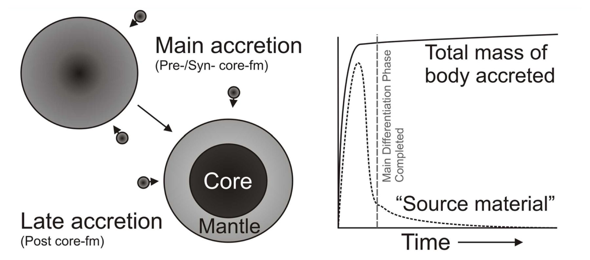
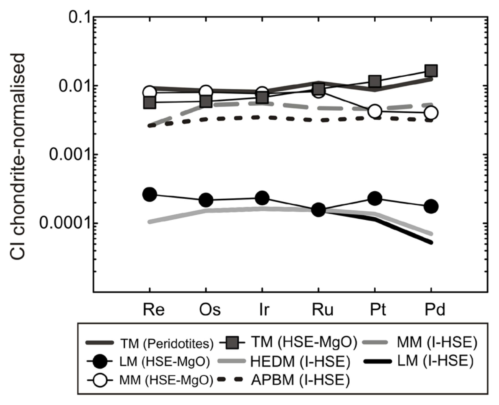
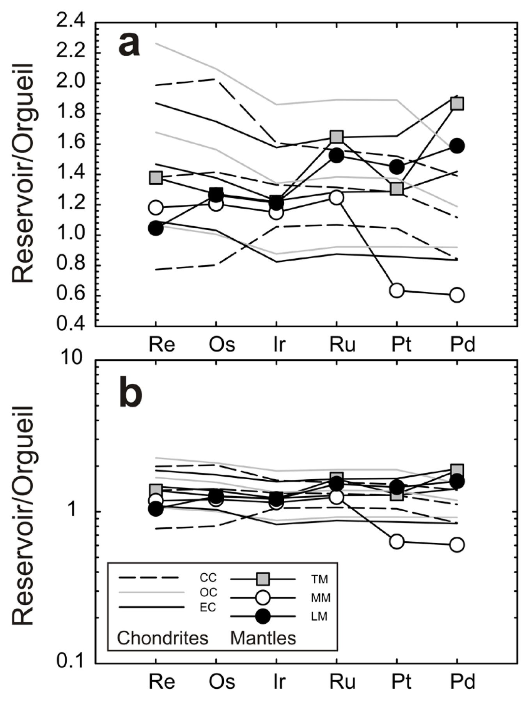
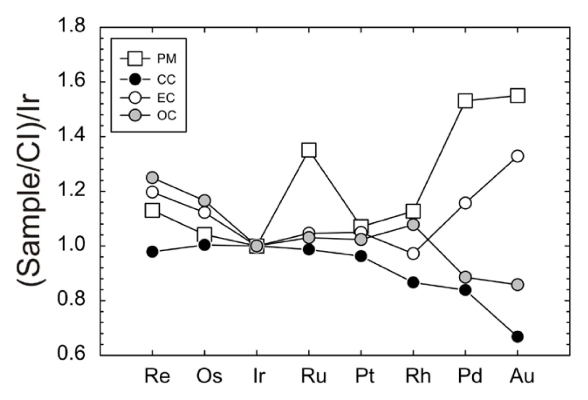
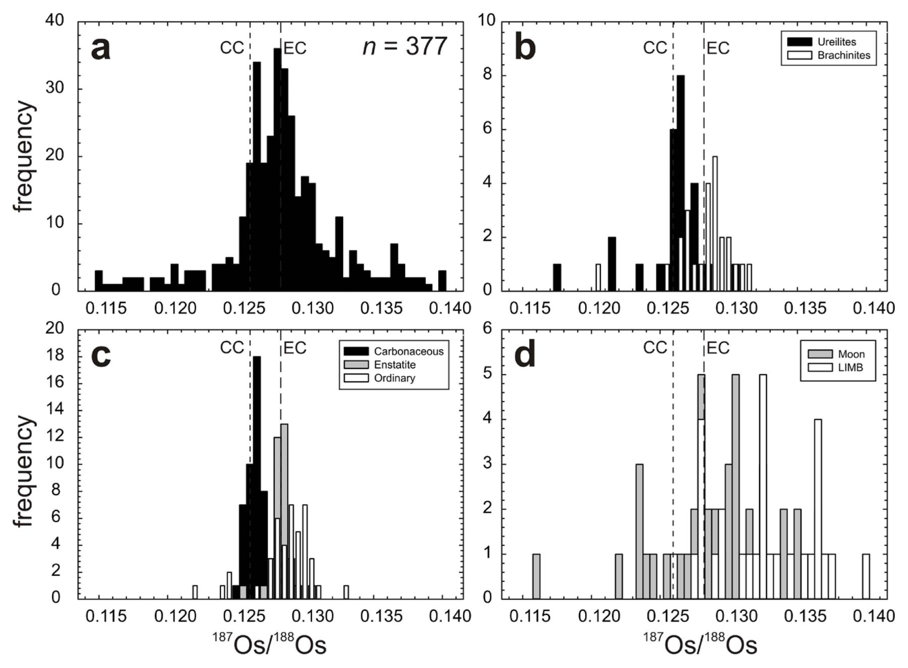
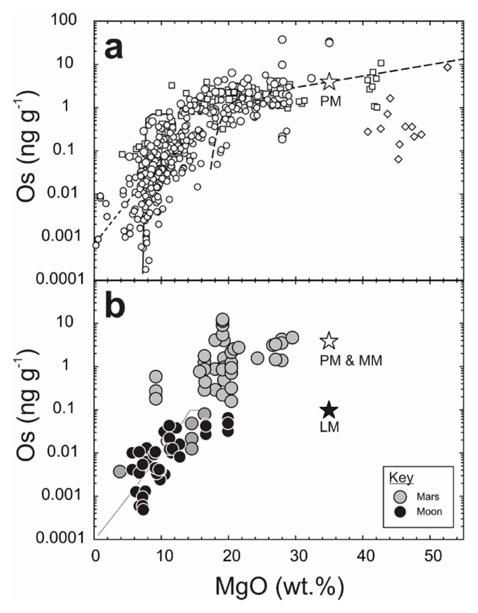
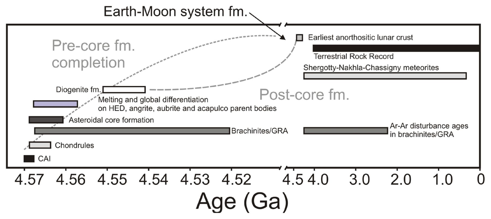
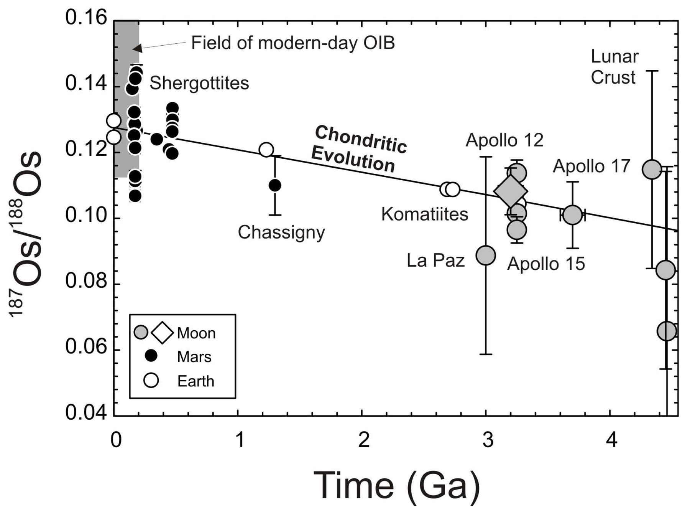
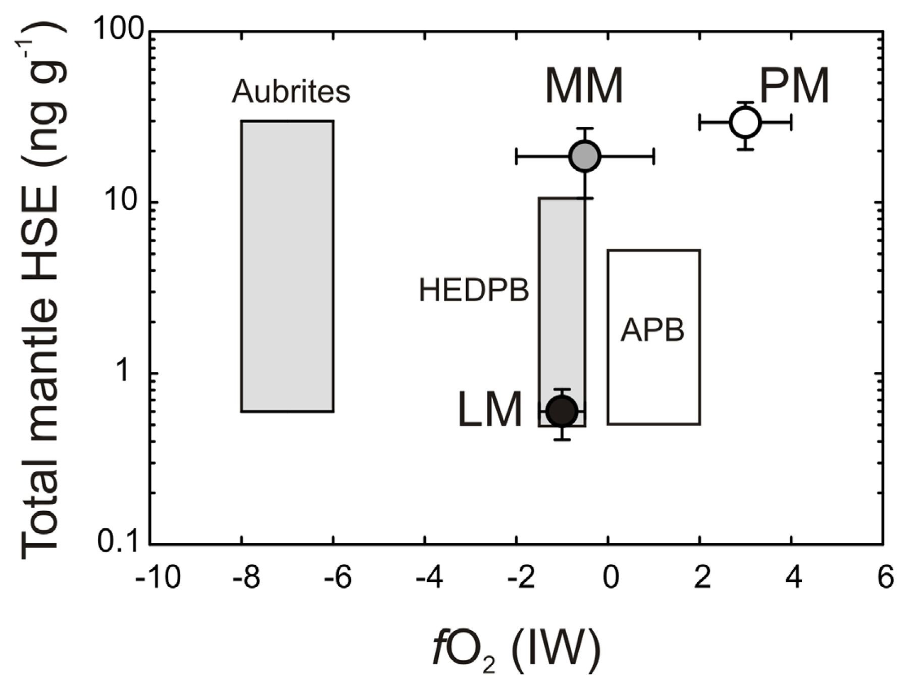

# Highly Siderophile Elements in Earth, Mars, the Moon, and Asteroids

> **一句话结论**
>
> 这篇 2016 年综述把“后增薄层”（late veneer）归纳为一条可检验的质量平衡链：地幔高亲铁元素（HSE）仅约 $0.009\times$ CI 球粒陨石、火星约 $0.007\times$ CI、月球约 $0.00022\times$ CI，而三者的长期 Re/Os 又接近球粒陨石，因此最简解释是核形成结束后再加入约 0.5% 硅酸盐质量的球粒陨石物质。但这个结论依赖“球粒陨石相对比例”“核形成已基本停止”“加入物质被保留并混合”三个前提；Pd/Au 的偏差、月球亏损和时间约束说明它更像一个“晚增生模型族”，而不是成分与时机都已确定的单一薄层。

## 0. 文献定位

- **研究类型**：综述（Reviews in Mineralogy and Geochemistry 第 81 卷第 4 章），不是新的实验或观测论文；它的价值在于把分散在陨石学、同位素地球化学和行星增生模型中的证据拼成一套判据。
- **研究对象与尺度**：Earth、Mars、Moon 及分异小行星；时间跨度从 CAI 形成（约 4.567 Ga）到现代火山岩；空间尺度为行星硅酸盐幔与金属核之间的元素分配。
- **在领域中的位置**：它承接 Walker (2009) 的 HSE 综述，系统整理了“后增薄层”假说的质量平衡、Os 同位素证据和竞争假说（不完全核分离、高压平衡分配）。2016 年之后用 Ru/Mo 核合成异常、高压实验和挥发分同位素检验这套框架的工作，基本都以这类综述为对话对象。
- **本文与证据包**：论文页面由 Chrome 实际打开（GeoScienceWorld 开放获取，Cloudflare 验证在浏览器内完成）；正文取自页面 `.article-body` 的 DOM，图件取自页面 “View large” 链接，45 幅图全部为浏览器来源（`browser`），未使用 PDF 裁切。网页正文没有页码，证据锚点统一用“节 + 段”。

**后增薄层研究脉络（按时间）**

| 时间 | 工作 | 核心贡献 | 与本文的关系 |
| :--- | :--- | :--- | :--- |
| 1974 | Kimura et al. | 金属/硅酸盐分配实验，提出用后增球粒陨石物质解释地幔 HSE | 本文追溯的历史起点 |
| 2009 | Walker | 系统综述 Earth/Moon/Mars 的 HSE 与 Os 同位素 | 本文的直接前身 |
| 2010 | Bottke et al. | 随机晚增生动力学，解释月球 HSE 亏损 | 本文引用的动力学方案之一 |
| 2012 | Dale et al. | 用小行星陨石把晚增生时间推到太阳系最初几个 Ma | 说明晚增生不是地球独有 |
| 2016 | Day, Brandon & Walker | 本综述：质量平衡、Os 同位素、替代假说与 45 幅图 | 本文主体 |
| 2023 | Wang et al. | 硫族同位素限制晚增薄层对地球挥发分的贡献 | 2016 年后的独立检验 |
| 2026 | Calvo et al. | 认为挥发分增生不需要晚增薄层 | 挑战“薄层”强版本 |
| 2026 | Blanchard et al. | 认为核形成本身可解释亲铁元素过剩 | 直接挑战 HSE 质量平衡的唯一性 |

## 1. 科学问题与假说

HSE（Os、Ir、Ru、Rh、Pt、Pd、Re、Au）在低压下对金属/硅酸盐的分配系数可达 $10^3$–$10^6$，低压定义通常要求大于 $10^4$（原文 §Introduction，第 1 段；§Motivation，第 1 段；Kimura et al., 1974）。如果地球由球粒陨石物质增生、并在核幔分异时达到平衡，那么 >98% 的 HSE 应进入金属核，留下的硅酸盐幔不仅丰度极低，而且各元素之间应出现明显分馏。实际观测却相反：地幔 HSE 丰度约为 $0.01\times$ CI，且多数元素保持球粒陨石相对比例，长期 Re/Os 与 Pt/Os 也分别在球粒陨石值的约 $\pm5\%$ 与 $\pm10\%$ 以内（原文 §Motivation，第 1 段）。

这就构成了后增薄层假说的出发点：在主要核形成阶段结束之后，行星又接收了一批 HSE 丰富的球粒陨石物质；这些物质没有参与金属-硅酸盐平衡，而是被混合进硅酸盐幔，从而把 HSE 丰度“抬”到观测值，同时保留球粒陨石相对比例。作者把这一过程称为 late accretion；对地球而言，若强调物质是加到表层的“薄层”，则称 late veneer（原文 §“Late-accretion”，第 1 段）。

由此可以列出四个可检验预测：

1. 地幔 HSE 应呈球粒陨石相对比例，而不是核形成实验预测的强分馏图案。
2. 长期 Re/Os 与 Pt/Os 应接近球粒陨石，因为 Re、Pt、Os 的相对比例未被核形成改变。
3. 增生量应与行星大小、撞击体保留率和混合效率有关；地球与火星可相近，月球应显著更低。
4. 加入时间应晚于主要核形成，但不一定同时发生于各天体。

需要说明的是，这是一篇综述，作者没有提出一个带明确零假设和统计检验的单一假说；上述四条是从正文论证中整理出的可检验含义，不是作者原话。

作者同时把两个竞争解释摆在桌面上：其一，核形成不完全，部分金属残留在地幔；其二，高压高温下 HSE 的金属-硅酸盐分配系数显著降低，使核形成本身就能留下观测到的 HSE（原文 §“Alternative hypotheses”，第 1–2 段）。后增薄层假说之所以成为主流，不是因为它被直接“看到”，而是因为它在多个天体上同时解释了“丰度低但比例近球粒陨石”这一组合。

> **关键前提**
>
> 1. **源物质**：地球整体 HSE 丰度大致类似球粒陨石；否则“>98% 进入核”的质量平衡不成立。
> 2. **核形成效率**：主要核形成阶段确实把 HSE 从硅酸盐中抽走，且没有留下大量金属。
> 3. **撞击体保留**：后增物质被行星保留并充分混合，而不是在撞击中逃逸或只停留在局部。
> 4. **样品代表性**：用玄武岩、橄榄岩和陨石反演的“幔源 HSE 丰度”能代表行星尺度的地幔。
> 5. **术语**：“球粒陨石”在这里主要指元素相对比例，不是绝对丰度；绝对丰度可以低几个数量级（原文 §“What do chondritic…”，第 1 段）。

## 2. 数据与方法

### 2.1 数据 / 样品

综述覆盖的材料类型很广：地球的造山带橄榄岩、深海橄榄岩、地幔捕虏体；月球 Apollo 与 Luna 返回样品、月球陨石、月海玄武岩与火山玻璃；火星陨石（shergottites、nakhlites、chassignites、NWA 7034/7533）；各类球粒陨石；铁陨石、石铁陨石；原始无球粒陨石、HED、aubrites、angrites 等。图 39 的汇编包含 >750 件行星材料，图 38 的 Os 同位素直方图包含 $n=377$ 个数据点（图 38、图 39 图注）。

样品年龄跨度很大：火星 shergottites 约 156–586 Ma，nakhlites 约 1300 Ma，NWA 7034 的部分组分可老至 4400 Ma（原文 §Mars，第 1 段）；月海玄武岩约 3–3.8 Ga，Apollo 样品总量约 382 kg，Luna 样品约 0.32 kg（原文 §The Moon，第 1 段）。这些年龄差异意味着“后增薄层”在不同天体上可能对应不同的时间窗口，不能用一个年龄统一描述。

### 2.2 方法 / 模型

核心分析方法是同位素稀释法测定 HSE 丰度，配合负热电离质谱（N-TIMS）测定 Os 同位素；部分样品用 LA-ICP-MS 做原位分析（原文 §Methods，第 1 段；§“The rhenium–osmium…”，第 1 段）。Re–Os 与 Pt–Os 的衰变常数分别为 $\lambda_{^{187}\mathrm{Re}}=1.6668\times10^{-11}\ \mathrm{a^{-1}}$ 与 $\lambda_{^{190}\mathrm{Pt}}=1.48\times10^{-12}\ \mathrm{a^{-1}}$（原文 §“The rhenium–osmium…”，第 1 段）。这两个体系一个半衰期约 42 Ga、一个约 470 Ga，正好覆盖行星尺度的时间演化。

从熔体反演地幔组成有两条路线：一条是把 HSE 对 MgO 做回归，外推到约 35 wt.% MgO 的幔源组成；另一条是利用两个相容性不同的 HSE 之间的协变，外推到高熔融程度时的源区比值（原文 §Estimation of planetary mantle composition，第 3 段）。两条路线给出的结果大体相近，但后者对月球和火星会给出非球粒陨石的 Re/Os 与 Pd/Os，进而预测的 $^{187}\mathrm{Os}/^{188}\mathrm{Os}$ 比实测低约 10–14%；前者与实测的偏差则分别在约 5%、0–2.5% 和 3% 以内（原文 §Estimation…，第 4 段）。这不是技术细节，而是后增薄层论证的关键方法学分歧：选择哪条反演路线，会直接影响“球粒陨石比例”这一结论的强度。

质量平衡本身是一个简单的比例估算：假设核形成抽走了 >99% 的 HSE，地幔观测丰度对应约 0.5% 的硅酸盐质量被球粒陨石物质加入（原文 §“Late-accretion”，第 2 段）。原文没有给出可复现的公式或代码，只给出数值和假设。

### 2.3 可复现性

论文是开放获取，正文、图件和参考文献都可从出版社页面直接读取；关键丰度数据在 Table 2 和 Table 3 中汇总。局限是：表格没有被拆成机器可读数据，图件是位图而非矢量；质量平衡的输入（球粒陨石绝对丰度、核形成残留比例、撞击体保留率）分散在正文和引文中，无法仅凭本文重算出 0.5% 这个数字。综述也没有提供代码或统一的样品筛选表。

## 3. 结果与图表逐图解读

### 图 2：后增薄层的定义图

*图 2：Schematic diagram illustrating the distinction between core-formation accretion and post-core formation accretion, also known as late accretion (or, in some cases, a ‘late veneer’ for Earth).（来源：browser；原始链接：https://pubs.geoscienceworld.org/msa/rimg/article/81/1/161/141067/Highly-Siderophile-Elements-in-Earth-Mars-the-Moon）*

> **读图要点**
>
> 左图是概念示意：主增生阶段（pre-/syn-core formation）把物质送入行星，金属下沉成核；后增生阶段（post-core formation）继续加入物质，但此时核已经基本停止吸收 HSE。右图是“总质量”和“源物质通量”随时间的示意图，纵轴没有数值，横轴是时间；虚线标出主分异阶段结束的位置。它不是数据图，不能用来看出加入量或加入时间。

这张图的作用是澄清术语，而不是提供证据。作者特意区分了 late accretion 与 late veneer：前者只要求“核形成之后仍有物质加入”，后者还暗示这些物质主要加在行星表层、形成一层薄薄的富 HSE 储库（原文 §“Late-accretion”，第 1 段）。这个区分很重要：如果后增物质是月球大小的巨大撞击体，它会把 HSE 混入很深的硅酸盐区域，甚至引发新一轮熔融，那就不是“薄层”，而是“晚增生事件”。因此，后文所有“0.5% 硅酸盐质量”的估算，本质上是在约束“加入量”，而不是在证明“薄层几何”。

### 图 8：地球、火星、月球的幔源 HSE 丰度

*图 8：Comparison of terrestrial mantle (TM) composition established from peridotites versus terrestrial, lunar (LM), martian (MM; I-HSE = dashed gray line), howardite-eucrite-diogenite (HEDM) and angrite parent body (APBM) mantle estimates based on HSE–MgO or interelement–HSE (I-HSE) covariation from volcanic products.（来源：browser；原始链接：https://pubs.geoscienceworld.org/msa/rimg/article/81/1/161/141067/Highly-Siderophile-Elements-in-Earth-Mars-the-Moon）*

> **读图要点**
>
> 纵轴是 CI 球粒陨石归一化的 HSE 丰度（对数，约 $10^{-4}$–$10^{-1}$），横轴依次为 Re、Os、Ir、Ru、Pt、Pd。粗线/方块是地球原始地幔的不同估计，空心圆是火星（HSE–MgO 法），实心圆是月球，灰色线是 HED 与 angrite 母体的元素间协变估计。地球与火星大多落在 $0.007$–$0.01\times$ CI，月球落在约 $2\times10^{-4}\times$ CI；火星的 Pt、Pd 明显低于地球，HED/APBM 的灰色线则更分散。

这张图是后增薄层假说的“主证据图”：它同时显示了两个事实——地球和火星的 HSE 绝对丰度相近，且都远高于核形成平衡所能留下的水平；月球则低约一个数量级以上（综合估计 20–120 倍；原文 §Estimation…，第 5 段）。图中的地球原始地幔估计来自 Becker et al. (2006)。如果只看“丰度低”，不完全核分离或高压分配也能解释；但要把三个天体都解释成“低丰度 + 近球粒陨石比例”，后增薄层的参数空间更自然。图 8 不能证明加入时间，也不能区分球粒陨石亚类；它支持的是“有一个后来的、球粒陨石来源的 HSE 储库被混入幔源”，而不是“这个储库一定是 CI 球粒陨石”。

### 图 9：球粒陨石与行星幔的线性/对数比较

*图 9：Plots of average, minimum (lower lines) and maximum (upper lines) HSE abundances for carbonaceous (CC), ordinary (OC) and enstatite (EC) chondrites versus mantle estimates for Earth (× 150; TM), Mars (× 150; MM) and the Moon (× 6000; LM).（来源：browser；原始链接：https://pubs.geoscienceworld.org/msa/rimg/article/81/1/161/141067/Highly-Siderophile-Elements-in-Earth-Mars-the-Moon）*

> **读图要点**
>
> (a) 线性纵轴、(b) 对数纵轴；横轴是 Re、Os、Ir、Ru、Pt、Pd。地球和火星的幔源估计被乘以 150，月球乘以 6000，目的是把它们放到与球粒陨石同一量级上比较。三条虚线/灰线分别代表 CC、OC、EC 的平均值及上下限。多数元素落在球粒陨石范围内，但火星的 Pt、Pd 偏低，地球的 Pd 偏高；线性面板放大了高丰度元素的差异，对数面板则强调“整体平行”。

这张图说明“broadly chondritic”到底有多宽：它不是逐元素完全一致，而是多数元素在球粒陨石范围内、且 Re/Os 能给出球粒陨石式的 $^{187}\mathrm{Os}/^{188}\mathrm{Os}$ 演化。图中的球粒陨石汇编来自 Horan et al. (2003)。作者在正文中把“nearly/broadly chondritic”定义为“多数 HSE 保持球粒陨石相对比例，且 Re/Os 为球粒陨石值”；如果所有元素比值都一致，才叫“chondritic”（原文 §“What do chondritic…”，第 1 段）。这个定义上的松动，是后增薄层假说能够容纳多种撞击体成分的原因，也是它难以被单一成分检验的原因。

### 图 35：原始地幔的 Pd/Au 偏差

*图 35：Plot of the estimated concentrations of the HSE in the primitive mantle (PM) double normalized to CI chondrite concentrations (Orgueil) and the ratio of Ir/CI.（来源：browser；原始链接：https://pubs.geoscienceworld.org/msa/rimg/article/81/1/161/141067/Highly-Siderophile-Elements-in-Earth-Mars-the-Moon）*

> **读图要点**
>
> 纵轴是“样品/CI 后再除以 Ir/CI”的双归一化值，横轴是 Re、Os、Ir、Ru、Pt、Rh、Pd、Au；Ir 被钉在 1。空心方块是原始地幔（PM），实心/灰色圆是 CC、EC、OC。PM 的 Ru 约为 1.3、Pd 约为 1.5、Au 约为 1.5，明显高于 Ir 基准；只有 EC 的 Pd、Au 能覆盖 PM 的范围。换句话说，PM 并不是一条水平线。

这张图是对“球粒陨石薄层”最直接的反例：如果后增物质是 CI 球粒陨石，PM 的 Pd/Au 应该接近 CI 的平坦图案；实际 PM 的 Pd、Au 相对 Ir 富集，只有 enstatite chondrite 能匹配（图 35 图注）。作者的解释是 Pd 和 Au 的冷凝温度较低、在星云中分布不均匀，因此它们不能像 refractory HSE 那样作为严格的球粒陨石指纹（原文 §“Initial conditions…”，第 4 段）。这留下两个可能：后增物质本身是 EC 类似的还原型物质，或者 Pd/Au 在增生/分异过程中被额外改造。无论哪一种，都说明“后增薄层 = CI 球粒陨石”是一个过强的说法。

### 图 38：$^{187}\mathrm{Os}/^{188}\mathrm{Os}$ 的总体分布

*图 38：Histograms of 187Os/188Os for (a) a compiled data set of > 350 planetary materials considered in this study, (b) ureilites and brachinites, (c) chondrites and (d) lunar mare basalts and crustal rocks (Moon) and lunar impact melt breccias (LIMB).（来源：browser；原始链接：https://pubs.geoscienceworld.org/msa/rimg/article/81/1/161/141067/Highly-Siderophile-Elements-in-Earth-Mars-the-Moon）*

> **读图要点**
>
> 四个面板的横轴都是 $^{187}\mathrm{Os}/^{188}\mathrm{Os}$，纵轴是频数；(a) 是全部 $n=377$ 个样品，(b) 是 ureilites/brachinites，(c) 是球粒陨石，(d) 是月球样品与撞击熔融角砾岩。竖虚线标出 CC（0.1262）、EC（0.1280）和 OC（0.1284）的平均值。总分布的主峰落在 EC/OC 之间，而不是 CC；ureilites 更靠近 CC，月球样品则更宽。

这张图把“球粒陨石”从一个抽象词变成了一个分布：太阳系内部天体的长期 Re/Os 大多落在 EC/OC 范围，只有 ureilites 等少数对象接近 CC（原文 §“Initial conditions…”，第 5 段）。因此，即使用 Os 同位素排除了“月球幔来自 CI 球粒陨石”的简单模型，也不能反过来证明后增物质就是 CC。分布重叠意味着单靠 Os 同位素无法唯一识别撞击体类别；这正是后来 Ru、Mo 核合成异常被引入的原因——它们能提供 Os 没有的“指纹”维度。

### 图 42：MgO–Os 关系与月球亏损

*图 42：Plots of MgO content (wt.%) versus Os (ng.g−1) for (a) terrestrial volcanic rocks and (b) martian meteorites and lunar mare basalts.（来源：browser；原始链接：https://pubs.geoscienceworld.org/msa/rimg/article/81/1/161/141067/Highly-Siderophile-Elements-in-Earth-Mars-the-Moon）*

> **读图要点**
>
> 横轴是 MgO（wt.%），纵轴是 Os（ng/g，对数）。(a) 是地球火山岩，虚线是不同硫含量和结晶分异路径的模型；(b) 是火星陨石（灰色圆）与月球样品（黑色圆），星号是 PM、MM、LM 的估计值。相同 MgO 下，月球样品的 Os 比火星/地球低约 40 倍；模型线说明这种偏移不能只用结晶分异解释，需要源区本身贫 Os。

图 42 把“月球为什么特殊”讲得最清楚：月球幔的 HSE 亏损不是几个样品的偶然，而是在 MgO–Os 系统中整体向左下偏移，对应源区 HSE 低约 40 倍（图 42 图注；原文 §COMPARATIVE PLANETOLOGY，第 2 段）。这给后增薄层模型出了一个难题：如果地球和月球在同一个地月系统里、经历了同一批撞击体，为什么月球只保留了这么少的 HSE？作者列出三种动力学解释——大撞击体的随机投送、小行星体残余群体的持续轰击、以及“侵蚀型增生”（撞击把物质打飞而非吸积）（原文 §“Late-accretion”，第 5 段）。这些都是模型，不是直接观测；月球 HSE 亏损的时间上限（应早于约 4.3–4.4 Ga 的月壳形成）也只是间接约束。

### 图 43：后增薄层在太阳系时间轴上的位置

*图 43：Time-scales of Solar System formation and post-core formation accretion.（来源：browser；原始链接：https://pubs.geoscienceworld.org/msa/rimg/article/81/1/161/141067/Highly-Siderophile-Elements-in-Earth-Mars-the-Moon）*

> **读图要点**
>
> 横轴是年龄（Ga），从 4.57 到 0；纵轴按对象排列：CAI、chondrules、小行星核形成、diogenite、HED/angrite/aubrite 母体熔融、Earth–Moon 系统形成、SNC 陨石、地球岩石记录。灰色虚线区分“pre-core formation completion”和“post-core formation”；注意横轴在 4.5 Ga 附近有断轴，早期与晚期被压缩在不同尺度上。

这张图支持一个相对顺序，而不是绝对年龄：小行星的核形成和 diogenite 的晚增生发生在太阳系形成后最初几个 Ma（Dale et al., 2012），而地球–月球系统的形成至少晚 30 Ma，地球的核生长更 protracted，因此地球和火星的晚增生可能不在同一时间窗口（图 43 图注；原文 §COMPARATIVE PLANETOLOGY，第 3 段）。这解释了为什么“地球和火星 HSE 丰度相近”不能直接推出“两者由同一批撞击体、在同一时间加入”。图 43 是示意图，线条宽度代表的是年龄范围而非误差棒；不能用它来读出精确的加入速率。

### 图 44：初始 Os 同位素与球粒陨石演化线

*图 44：Calculated initial 187Os/188Os values for martian meteorites, lunar mare basalts and pristine crustal rocks and terrestrial komatiites and peridotites plotted relative to the averaged ‘chondritic evolution’ curve of carbonaceous chondrites.（来源：browser；原始链接：https://pubs.geoscienceworld.org/msa/rimg/article/81/1/161/141067/Highly-Siderophile-Elements-in-Earth-Mars-the-Moon）*

> **读图要点**
>
> 横轴是时间（Ga），纵轴是初始 $^{187}\mathrm{Os}/^{188}\mathrm{Os}$；黑色实线是碳质球粒陨石的平均演化曲线。圆点/方块分别代表火星（shergottites、Chassigny）、月球（Apollo 12/15/17、La Paz）和地球（komatiites）。多数数据落在曲线附近，但月球样品在 3–4 Ga 处有较大垂直散布，La Paz 的误差棒尤其长；火星点集中在 0–0.5 Ga、比值 0.12–0.145。

这张图是“长期 Re/Os 近球粒陨石”的直观证据：如果月球或火星幔的 Re/Os 被核形成强烈分馏，初始 Os 同位素应系统偏离球粒陨石演化线；实际大多数点落在曲线附近（原文 §COMPARATIVE PLANETOLOGY，第 4 段；Day & Walker, 2015）。但“落在曲线附近”并不等于“后增薄层在某个具体时间加入”：初始比值同时取决于 Re/Os 和年龄，图上的一条曲线可以被“较早加入、较高 Re/Os”或“较晚加入、较低 Re/Os”多组参数拟合。图 44 支持的是长期预算，而不是一次性事件的精确年代。

### 图 45：氧化还原状态与 HSE 丰度

*图 45：Total HSE concentration estimated for parent bodies versus oxidation state (log units relative to iron-wüstite buffer).（来源：browser；原始链接：https://pubs.geoscienceworld.org/msa/rimg/article/81/1/161/141067/Highly-Siderophile-Elements-in-Earth-Mars-the-Moon）*

> **读图要点**
>
> 横轴是相对铁-方铁矿缓冲的氧逸度 $f\mathrm{O}_2$（IW，对数单位），纵轴是母体总 HSE 丰度（ng/g，对数）。灰色框是 aubrites、HED 母体（HEDPB）和 angrite 母体（APB）的范围；圆点是月球（LM）、火星（MM）和原始地幔（PM）。PM 落在较氧化的一端（约 IW+3），MM/LM 落在较还原的一端（约 IW−1），但两者 HSE 丰度差异并不随 $f\mathrm{O}_2$ 单调变化。

这张图用来检验“氧化还原控制 HSE”的替代解释：如果 HSE 丰度主要由 $f\mathrm{O}_2$ 决定，那么从 aubrites 到 PM 应该看到单调趋势；实际分布很散，PM 与 MM/LM 的 $f\mathrm{O}_2$ 差别很大，但 HSE 丰度并不按同一斜率变化（原文 §COMPARATIVE PLANETOLOGY，第 5 段）。作者因此认为，$f\mathrm{O}_2$ 重要但不是一阶控制因素；这为“后增薄层”留出了空间，但也暴露了该图的一个弱点：不同母体的 $f\mathrm{O}_2$ 估计本身不确定性很大，样本数也少，难以做定量回归。

## 4. 机制与讨论

把全文的论证拆开，可以得到一条清晰的因果链：

1. **核形成抽走 HSE**：HSE 的金属/硅酸盐分配系数高，核形成后硅酸盐幔应极度亏损且元素间强烈分馏（原文 §Introduction，第 1 段）。
2. **观测到“低但近球粒陨石”**：地球、火星、月球的幔源 HSE 丰度分别约为 $0.009$、$0.007$、$0.00022\times$ CI，且长期 Re/Os 接近球粒陨石（原文 §Estimation…，第 5 段；§Motivation，第 1 段）。
3. **需要一个后核形成的 HSE 源**：最自然的解释是球粒陨石撞击体在核形成结束后加入，并被混合进硅酸盐幔（原文 §“Late-accretion”，第 1–2 段）。
4. **用质量平衡定量**：约 0.5% 的硅酸盐质量、相当于地球 3–4.8×10²² kg、火星 4–5×10²¹ kg、月球 1.47×10¹⁹ kg 的球粒陨石物质（原文 §“Late-accretion”，第 6 段）。

这条链中，**直接证据**是 HSE 丰度和 Os 同位素；**推断**是撞击体成分、加入时间和“薄层”几何。作者自己反复强调，后增薄层是一个“最可能”的解释，而不是唯一解释：不完全核分离和高压平衡分配都能在参数上调出类似丰度，但前者难以同时满足所有 HSE 的相对比例，后者在月球这样的小天体上（中心压力约 4 GPa）根本不适用（原文 §“Alternative hypotheses”，第 1–3 段）。这是该假说最强的逻辑支点：不是某一个天体拟合得好，而是“从地球到小行星”都出现近球粒陨石比例，用一个贯穿不同大小的机制解释更经济。

与既有文献的关系可以概括为三点。第一，它与 Walker (2009) 的结论一致：HSE 是示踪后增薄层最直接的元素族，Os 同位素提供时间维度。第二，它与“月球 HSE 亏损”的经典难题正面冲突：如果地月系统共享同一批撞击体，月球为什么少这么多？作者没有给出唯一答案，而是把 Bottke et al. (2010) 的随机投送、小行星体持续轰击和侵蚀型增生并列。第三，它把“后增薄层”与“晚增生”区分开：前者暗示表层加入，后者可以是灾难性混合；这个区分在 2016 年后被 Ru/Mo 同位素和动力学模拟进一步放大。

2016 年之后的进展（本笔记补充，不在原文证据包内）让这幅图更复杂：Ru、Mo 核合成异常被用来区分撞击体来源；高压实验显示在核幔边界条件下 HSE 的分配行为可能与低压实验不同；2026 年两篇 Science Advances 论文分别从挥发分和亲铁元素角度提出“不需要后增薄层”的替代方案（Wang et al., 2023；Calvo et al., 2026；Blanchard et al., 2026）。这些工作并没有推翻“核形成后仍有物质加入”这一宽泛命题，但确实削弱了“必须用一个球粒陨石薄层来解释所有 HSE”的强版本。阅读这篇 2016 年综述时，应把它当作“假说的证据基础与判据清单”，而不是最终裁决。

## 5. 局限性与不确定性

> **边界条件与未解问题**
>
> 1. **样品/数据边界**：幔源 HSE 丰度是从玄武岩、橄榄岩和陨石反演的，不是直接采样；月球样品受月壳混染和撞击熔融影响，火星陨石受地球/火星表面蚀变影响（原文 §Mars，第 4 段；§The Moon，第 4 段）。
> 2. **方法/模型边界**：MgO 回归与元素间协变两条路线给出的 Re/Os 不同，后者对月球/火星预测的 $^{187}\mathrm{Os}/^{188}\mathrm{Os}$ 比实测低 10–14%（原文 §Estimation…，第 4 段）；选择哪条路线会改变“球粒陨石”结论的强度。
> 3. **参数敏感性**：0.5% 硅酸盐质量依赖“核形成抽走 >99% HSE”“撞击体被完整保留”“球粒陨石绝对丰度”等假设；球粒陨石类别（CC/OC/EC）和撞击体粒度都会改变结果（原文 §“Late-accretion”，第 2 段）。
> 4. **术语外推**：“broadly chondritic”允许 Pd/Au 等元素偏离；图 35 显示 PM 的 Pd、Au 只有 EC 能匹配，因此“球粒陨石薄层”不能简单等同于 CI 成分（图 35；原文 §“What do chondritic…”，第 1 段）。
> 5. **时间约束**：地球、火星、月球的晚增生时间只有间接约束；图 43 是示意图，图 44 的初始 Os 比值可以被多组 Re/Os–年龄组合拟合，不能给出精确年代。
> 6. **文献时效**：本文截稿于 2016 年，未覆盖 Ru/Mo 核合成异常、高压 HSE 实验和 2020 年代挥发分同位素结果；这些后续工作对“薄层”的成分和必要性提出了新约束。

作者自己承认的局限主要是：质量平衡的不确定性、样品“原始性”的判定、月球亏损的动力学解释不唯一、以及晚增生时间约束很弱（原文 §“Late-accretion”，第 2、5 段；§FUTURE DIRECTIONS，第 8 段）。本笔记另外指出两点作者讨论较少的问题：其一，“后增薄层”与“晚增生”在文中有时混用，导致“薄层几何”被不必要地绑定到质量平衡结论上；其二，综述以 HSE 和 Os 同位素为主，对挥发分、Mo/W 同位素和动力学模拟的交叉检验着墨较少，读者若只读这篇，容易高估 HSE 证据的唯一性。

## 6. 可复用要点

- **可直接引用的结论**：地球原始地幔 HSE 约 $0.009\pm0.003\times$ CI，火星约 $0.007\pm0.004\times$ CI，月球约 $0.00022\pm0.00006\times$ CI；三者长期 Re/Os 接近球粒陨石；最简解释是核形成后加入约 0.5% 硅酸盐质量的球粒陨石物质（原文 §Estimation…，第 5 段；§“Late-accretion”，第 1–2 段）。
- **可复用的方法/参数**：用 MgO–HSE 回归反演幔源组成；用 Re–Os 与 Pt–Os 双体系检验长期 Re/Os、Pt/Os；用 $^{187}\mathrm{Os}/^{188}\mathrm{Os}$ 初始值判断是否经历过核形成分馏。注意元素间协变法会给出非球粒陨石 Re/Os，不适合单独作为“球粒陨石”判据。
- **需要谨慎的地方**：“后增薄层”不等于“CI 球粒陨石薄层”；Pd/Au 偏差、月球 40 倍亏损、以及 0.5% 的质量平衡都依赖模型假设。引用时最好写成“约 0.5% 硅酸盐质量的晚增生”，而不是“地球表面有一层 0.5% 的球粒陨石”。
- **下一步可验证的问题**：用 Ru/Mo 核合成异常独立约束撞击体类别；用高压实验检验核幔边界条件下的 HSE 分配；用月球样品的高精度年代学限定月球晚增生的时间上限；用动力学模拟检验“随机投送/侵蚀型增生”能否同时匹配地球、火星和月球的 HSE 预算。

## 7. 参考文献

- Day, J. M. D., Brandon, A. D., & Walker, R. J. (2016). Highly siderophile elements in Earth, Mars, the Moon, and asteroids. *Reviews in Mineralogy and Geochemistry, 81*(1), 161–238. https://doi.org/10.2138/rmg.2016.81.04
- Becker, H., Horan, M. F., Walker, R. J., Gao, S., Lorand, J.-P., & Rudnick, R. L. (2006). Highly siderophile element composition of the Earth’s primitive upper mantle: Constraints from new data on peridotite massifs and xenoliths. *Geochimica et Cosmochimica Acta, 70*(17), 4528–4550. https://doi.org/10.1016/j.gca.2006.06.004
- Blanchard, I., Siebert, J., Calvo, L., Lobanov, S. S., Pinchon, C., Kubik, E., Wilke, M., Schreiber, A., Bonino, V., Guyot, F., Petitgirard, S., & Parisiades, P. (2026). Core formation resolves Earth’s siderophile excess without a late veneer. *Science Advances, 12*(39). https://doi.org/10.1126/sciadv.aef0411
- Bottke, W. F., Walker, R. J., Day, J. M. D., Nesvorný, D., & Elkins-Tanton, L. (2010). Stochastic late accretion to Earth, the Moon, and Mars. *Science, 330*(6010), 1527–1530. https://doi.org/10.1126/science.1196874
- Brandon, A. D., Puchtel, I. S., Walker, R. J., Day, J. M. D., Irving, A. J., & Taylor, L. A. (2012). Evolution of the martian mantle inferred from the $^{187}\mathrm{Re}$–$^{187}\mathrm{Os}$ isotope and highly siderophile element abundance systematics of shergottite meteorites. *Geochimica et Cosmochimica Acta, 76*, 206–235. https://doi.org/10.1016/j.gca.2011.09.047
- Calvo, L., Siebert, J., Huang, D., Blanchard, I., Kubik, E., Bonino, V., Schreiber, A., Avice, G., & Labidi, J. (2026). Accretion of volatile elements on Earth without the need of a late veneer. *Science Advances, 12*(9). https://doi.org/10.1126/sciadv.ady8018
- Dale, C. W., Burton, K. W., Greenwood, R. C., Gannoun, A., Wade, J., Wood, B. J., & Pearson, D. G. (2012). Late accretion on the earliest planetesimals revealed by the highly siderophile elements. *Science, 336*(6077), 72–75. https://doi.org/10.1126/science.1214967
- Day, J. M. D. (2013). Hotspot volcanism and highly siderophile elements. *Chemical Geology, 341*, 50–74. https://doi.org/10.1016/j.chemgeo.2012.12.010
- Day, J. M. D., & Walker, R. J. (2015). Highly siderophile element depletion in the Moon. *Earth and Planetary Science Letters, 423*, 114–124. https://doi.org/10.1016/j.epsl.2015.05.001
- Horan, M. F., Walker, R. J., Morgan, J. W., Grossman, J. N., & Rubin, A. E. (2003). Highly siderophile elements in chondrites. *Chemical Geology, 196*(1–4), 27–42. https://doi.org/10.1016/S0009-2541(02)00405-9
- Kimura, K., Lewis, R. S., & Anders, E. (1974). Distribution of gold and rhenium between nickel-iron and silicate melts: Implications for the abundance of siderophile elements on the Earth and Moon. *Geochimica et Cosmochimica Acta, 38*(5), 683–701. https://doi.org/10.1016/0016-7037(74)90144-6
- Mann, U., Frost, D. J., Rubie, D. C., Becker, H., & Audétat, A. (2012). Partitioning of Ru, Rh, Pd, Re, Ir and Pt between liquid metal and silicate at high pressures and high temperatures: Implications for the origin of highly siderophile element concentrations in the Earth’s mantle. *Geochimica et Cosmochimica Acta, 84*, 593–613. https://doi.org/10.1016/j.gca.2012.01.026
- Walker, R. J. (2009). Highly siderophile elements in the Earth, Moon and Mars: Update and implications for planetary accretion and differentiation. *Geochemistry, 69*(2), 101–125. https://doi.org/10.1016/j.chemer.2008.10.001
- Wang, W., Walter, M. J., Brodholt, J. P., Huang, S., & Petaev, M. I. (2023). Chalcogen isotopes reveal limited volatile contribution from late veneer to Earth. *Science Advances, 9*(49). https://doi.org/10.1126/sciadv.adh0670

---

*本笔记由 Agent 基于浏览器证据包撰写。全文与 45 幅图取自 GeoScienceWorld 开放获取页面（Chrome + browser-use）；图片为 `papers/` 内的相对路径。*
