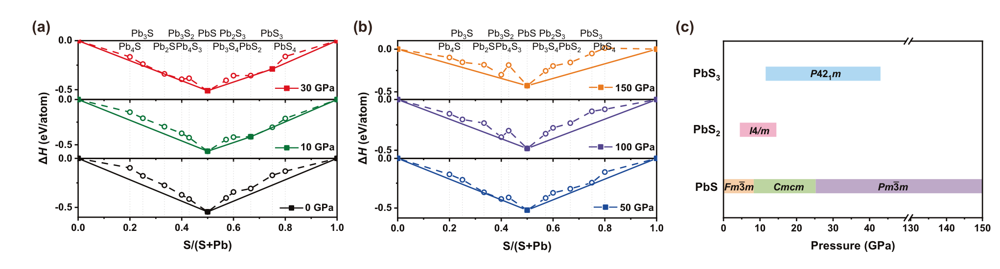
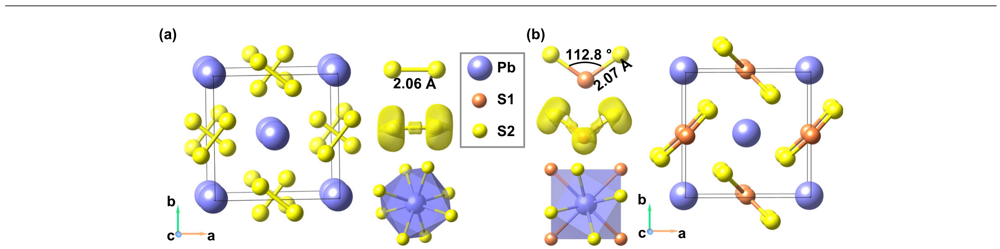
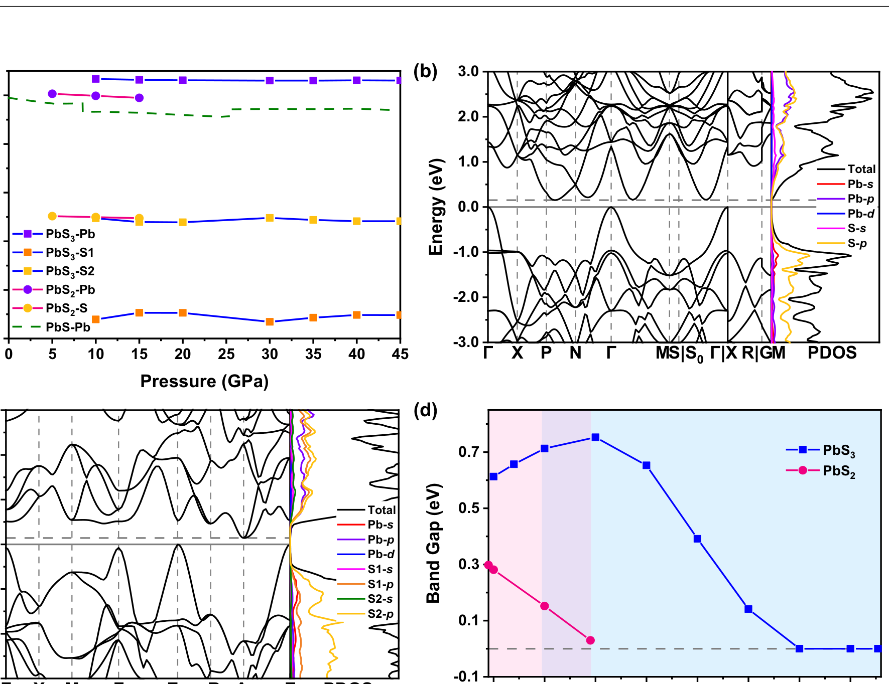
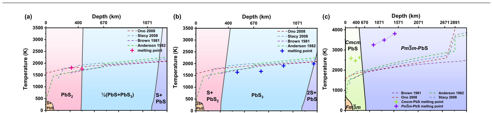

# 地球铅悖论（Lead Paradox）：从"失踪的铅"到高压硫化铅储库

> **文献类型**：经典文献分析（Classic Literature Review）＋ 前沿论文精读
>
> **锚定论文**：Liu, S., Guo, M., Yu, S., & Redfern, S. A. T. (2026). *Hidden pressure-stabilized lead reservoirs in Earth's mantle*. **Nature Communications**, 17, 2913.
>
> **DOI**：[10.1038/s41467-026-69772-8](https://doi.org/10.1038/s41467-026-69772-8)
>
> **收稿 / 接收 / 在线**：2025-11-25 / 2026-02-09 / 2026-02-18
>
> **开放获取**：CC BY-NC-ND 4.0
>
> **数据与代码**：Figshare [10.6084/m9.figshare.31083322](https://doi.org/10.6084/m9.figshare.31083322)；CALYPSO、VASP、Quantum ESPRESSO、Phonopy
>
> **分析日期**：2026-10-24

---

## 摘要

地球铅悖论（Pb paradox）是指：可及硅酸盐地球（地壳＋可采样地幔）的铅同位素组成明显比球粒陨石更富放射成因铅，落在"地球等时线"（geochron）右侧；若地球整体与球粒陨石同源且质量守恒，则必然存在一个富含非放射成因铅（²⁰⁴Pb）的隐蔽储库。自 Patterson (1956) 建立 Pb–Pb 定年框架以来，围绕该储库的位置与载体，学界先后提出了地核吸积、下地壳／岩石圈地幔硫化物、非球粒陨石地球等多种假说。

Liu et al. (2026) 以第一性原理结构预测与熔点计算，系统考察了 Pb–S 体系在 0–150 GPa 的相稳定性，提出高压硫化铅（PbS）及多硫化铅（PbS₂、PbS₃）可作为深部非放射成因铅的长期载体。其核心论证是：PbS 的熔点显著高于地温线，可在核幔边界条件下保持晶质；PbS₂ 同样以固相稳定存在；而 PbS₃ 熔点较低，可在上升流中部分熔融并分解释放少量古老铅。该工作为"铅在硅酸盐地球内部被封存"提供了热力学可行性论证，但尚未给出储库规模的定量约束，也仍待高温高压实验检验。

> **一句话结论**
>
> 铅悖论的解决思路正在从"铅去了哪里"转向"铅以什么相、在什么 P–T–redox 条件下被长期隔离"。Liu et al. (2026) 的贡献是把硫化物载体从定性猜想推进到可计算的相图与熔点约束，但它证明的是**热力学可行性**，不是**质量平衡的闭合**。

---

## 1. 问题的提出：什么是铅悖论

### 1.1 四同位素体系

铅有四种稳定同位素。其中 ²⁰⁴Pb 为非放射成因（"原始铅"或"普通铅"），其总量自地球形成以来基本不变；²⁰⁶Pb、²⁰⁷Pb、²⁰⁸Pb 分别由 ²³⁸U、²³⁵U、²³²Th 经衰变链产生。

| 同位素 | 成因 | 母体 | 半衰期 | 地球化学意义 |
| :--- | :--- | :--- | :--- | :--- |
| ²⁰⁴Pb | 非放射成因 | — | — | 归一化基准；记录原始铅预算 |
| ²⁰⁶Pb | 放射成因 | ²³⁸U | 44.68 亿年 | 与 ²⁰⁷Pb 构成 Pb–Pb 等时线 |
| ²⁰⁷Pb | 放射成因 | ²³⁵U | 7.04 亿年 | 对早期分异高度敏感 |
| ²⁰⁸Pb | 放射成因 | ²³²Th | 140.1 亿年 | 约束 Th/Pb 与 κ 值 |

### 1.2 地球等时线与"零地球等时线"

在单阶段封闭体系假设下，现今铅同位素比值可写为：

$$
\left(\frac{^{206}\mathrm{Pb}}{^{204}\mathrm{Pb}}\right)_{\mathrm{now}}
=
\left(\frac{^{206}\mathrm{Pb}}{^{204}\mathrm{Pb}}\right)_{0}
+
\left(\frac{^{238}\mathrm{U}}{^{204}\mathrm{Pb}}\right)
\left(e^{\lambda_{238}T}-1\right)
$$

$$
\left(\frac{^{207}\mathrm{Pb}}{^{204}\mathrm{Pb}}\right)_{\mathrm{now}}
=
\left(\frac{^{207}\mathrm{Pb}}{^{204}\mathrm{Pb}}\right)_{0}
+
\left(\frac{^{235}\mathrm{U}}{^{204}\mathrm{Pb}}\right)
\left(e^{\lambda_{235}T}-1\right)
$$

其中 $T$ 为体系年龄，$\lambda_{238}$、$\lambda_{235}$ 为衰变常数。以 Canyon Diablo 铁陨石陨硫铁的初始铅（²⁰⁶Pb/²⁰⁴Pb = 9.307，²⁰⁷Pb/²⁰⁴Pb = 10.294）为起点，取地球年龄 $T \approx 4.567\ \mathrm{Ga}$，可得到一条"地球等时线"（geochron）。若地球各储库始终保持封闭且 U/Pb 均一，所有地幔与地壳岩石都应落在这条线上。Stacey & Kramers (1975) 的两阶段演化模型则给出了此后广泛使用的普通铅增长曲线参考。

> **悖论的定义**
>
> 实际观测中，大洋中脊玄武岩（MORB）与洋岛玄武岩（OIB）的 ²⁰⁶Pb/²⁰⁴Pb、²⁰⁷Pb/²⁰⁴Pb 系统性地落在零地球等时线**右侧**，即比全硅酸盐地球（BSE）理论值更富放射成因铅。这意味着可及地球的 U/Pb 有效值偏高，或者有一部分非放射成因铅被"藏"在了未被采样的储库中。

### 1.3 质量守恒的约束

设全地球铅预算为 $M_{\mathrm{Pb}}^{\mathrm{total}}$，可及硅酸盐地球为 $M_{\mathrm{Pb}}^{\mathrm{acc}}$，隐蔽储库为 $M_{\mathrm{Pb}}^{\mathrm{hid}}$，则：

$$
M_{\mathrm{Pb}}^{\mathrm{total}}
=
M_{\mathrm{Pb}}^{\mathrm{acc}}
+
M_{\mathrm{Pb}}^{\mathrm{hid}}
$$

若 $M_{\mathrm{Pb}}^{\mathrm{acc}}$ 的同位素组成过于放射成因，则 $M_{\mathrm{Pb}}^{\mathrm{hid}}$ 必须由低 ²⁰⁶Pb/²⁰⁴Pb、低 ²⁰⁷Pb/²⁰⁴Pb 的铅构成。问题的关键转化为：**这个储库在哪里、以什么矿物相存在、为何能在 45 亿年中与 U/Th 保持隔离？**

### 1.4 两类主要假说

Liu et al. (2026) 将既有假说归纳为两类：

1. **隐蔽储库假说**：非放射成因铅被封存在地核或深部地幔。地核路径依赖核幔分异时 Pb 的亲铁／亲硫行为；深部地幔路径依赖硫化物或其他高密度相。
2. **非球粒陨石地球假说**：地球整体并非球粒陨石成分，挥发分亏损、碰撞侵蚀或吸积过程改变了 Pb/U/Th 预算，因此"悖论"部分源于基准选择，而非单纯的储库缺失。

这两类假说并不互斥。Liu et al. (2026) 明确采用**球粒陨石 BSE** 作为前提，聚焦第一类假说中的硅酸盐地球内部机制。

---

## 2. 经典文献脉络

铅悖论的研究史可以概括为四个阶段：**定年框架的建立 → 多储库质量平衡 → 硫化物载体的提出 → 高压矿物物理的介入**。

| 阶段 | 代表文献 | 核心贡献 | 主要局限 |
| :--- | :--- | :--- | :--- |
| 定年奠基 | Patterson (1956) | Pb–Pb 等时线测定地球年龄 4.55 ± 0.07 Ga | 假设地球整体均一演化 |
| 早期分异 | Allègre (1968); Vollmer (1977) | 把 Pb 异常与地幔—地壳—地核分异联系起来 | 地核 Pb 分配系数缺乏实验约束 |
| 多箱模型 | Allègre & Lewin (1989) | 三箱模型与多体系同位素反演 | 储库划分与交换过程简化 |
| 悖论形式化 | Galer & Goldstein (1996); Kramers & Tolstikhin (1997) | 系统讨论两个 Pb 同位素悖论与核幔分异 | 仍以模型拟合为主 |
| 硫化物路径 | Hart & Gaetani (2006); Hofmann (2008); Lagos et al. (2008) | 提出"硫化物解决方案"，质疑地核储库 | 缺乏深部相稳定性约束 |
| 观测证据 | Malaviarachchi et al. (2008); Burton et al. (2012); Mougel et al. (2014); Zhang et al. (2020) | 发现地幔橄榄岩／硫化物中的高非放射成因铅 | 储库规模与全球代表性存疑 |
| 基准反思 | Maltese & Mezger (2020); Doucet et al. (2023) | 讨论非球粒陨石 BSE 与动态演化框架 | 与球粒陨石基准之争未决 |
| 矿物物理 | Liu et al. (2026) | 高压 Pb–S 相图、熔点与储库机制 | 纯计算，未实验验证；二元体系简化 |

### 2.1 Patterson (1956)：定年框架与悖论的起点

Patterson 用 Canyon Diablo 铁陨石（特别是陨硫铁）测定太阳系初始铅，并以现代海洋沉积物的平均铅作为现今地球铅，建立 Pb–Pb 等时线，得到地球年龄 4.55 ± 0.07 Ga。这项工作确立了"以陨石初始值 + 地球现今值反演年龄"的方法论。

其隐含假设是：地球铅同位素演化可以用一个均一体系近似。正是这一假设，使得后来观测到的 MORB/OIB 系统性偏离成为"悖论"。从这个意义上说，Patterson 既给出了地球年龄的基准，也埋下了铅悖论的种子。

### 2.2 Allègre (1968) 与 Vollmer (1977)：把铅放进分异框架

Allègre (1968) 较早系统讨论了上地幔 U–Th–Pb 体系的行为，提出地幔—地壳分异会造成 Pb 同位素的系统性偏移。Vollmer (1977) 则把地核形成时间引入铅同位素演化：如果核幔分异时 Pb 优先进入金属相，而 U 留在硅酸盐相，则硅酸盐地球的 U/Pb 升高，经长期衰变后必然更富放射成因铅。

这一思路逻辑自洽，但其关键参数——Pb 在金属–硅酸盐之间的分配系数——在当时缺乏可靠实验约束。后续高温高压实验表明，Pb 的亲铁性不足以让地核单独吞下所需数量的铅；Kramers & Tolstikhin (1997) 综合质量平衡后指出，地核最多只能容纳平衡地幔—地壳同位素所需铅量的约 30%。这成为"地核储库假说"面临的核心困难。Allègre et al. (2008) 进一步把地球主要分异事件的时间约束在约 4.45 Ga，为核幔分异与早期地壳形成的讨论提供了时间框架。

### 2.3 Allègre & Lewin (1989)：三箱模型与定量反演

Allègre 与 Lewin 将地球划分为大陆地壳、上地幔（MORB 源区）与下地幔／地核三个箱体，利用 Sr–Nd–Hf–Pb 多体系同位素数据进行非线性反演，试图在质量守恒约束下同时拟合各储库的组成。

这项工作的意义在于：铅悖论不再是单一体系的"数据噪声"，而是多体系同位素共同指示的真实分异格局。其局限在于箱体划分过于简化，且对储库之间的交换通量、时间尺度与地核 Pb 行为的处理仍受当时数据精度限制。

### 2.4 Kramers & Tolstikhin (1997) 与 Murphy et al. (2003)：两个悖论与"精化解"

Kramers & Tolstikhin (1997) 系统区分了两个 terrestrial Pb isotope paradoxes：

- **第一悖论**：可及地球过于放射成因，暗示缺失非放射成因铅储库。
- **第二悖论（κ 悖论）**：由 Pb 同位素反演的地幔 Th/U（κ）偏高，与其他地球化学约束不一致。

他们通过前向输运模型（forward transport modelling）把核幔分异、大陆地壳生长与地幔对流耦合起来，指出地核只能解释部分质量亏损，必需额外的硅酸盐地球储库。Murphy, Kamber & Collerson (2003) 则尝试用下地壳／亏损地幔的组合给出"第一悖论"的精化质量平衡解，强调下地壳的 Pb 同位素组成与储量是关键约束。Rudnick & Goldstein (1990) 对下地壳捕虏体的 Pb 同位素研究则表明，下地壳的组成与储量难以单独闭合质量平衡。

### 2.5 Hart & Gaetani (2006)、Hofmann (2008)、Lagos et al. (2008)：硫化物方案

Hart & Gaetani (2006) 明确提出"Mantle Pb paradoxes: the sulfide solution"：Pb 是强亲硫元素，地幔中的硫化物（尤其是残余硫化物）可以优先富集 Pb，并将其与 U/Th 分离。由于硫化物在部分熔融中常作为难熔残余相保留，它可以在很长时间尺度上维持低 U/Pb，从而成为一个"隐藏的"非放射成因铅储库。

Hofmann (2008) 在 *Nature Geoscience* 的评论 "The enduring lead paradox" 中总结了这一困局：无论地核、下地壳还是地幔硫化物，都面临"储量是否足够、机制是否可持续"的双重拷问。Lagos et al. (2008) 则以高温高压实验与质量平衡论证"地球失踪的铅可能并不在地核"，把讨论重新引回硅酸盐地球。Wood & Halliday (2010) 则主张，仅靠地核形成即可解释地球的 Pb 同位素年龄，重新强调了地核路径的可能性；这与硫化物方案形成持续的方法学张力。

> **关键转折**
>
> 硫化物方案的提出，使铅悖论从"储库位置"问题转变为"矿物载体与保存机制"问题。但它长期缺乏一个核心证据：在深部地幔的 P–T 条件下，含铅硫化物究竟以什么相存在、能否长期保持固态？

### 2.6 观测证据：地幔中的高非放射成因铅

一系列观测为硫化物储库提供了间接支持：

- **Horoman 橄榄岩（日本）**：Malaviarachchi et al. (2008) 报道了极低 ²⁰⁶Pb/²⁰⁴Pb 的铅同位素组成，指示地幔中存在长期低 U/Pb 的储库。
- **深海橄榄岩硫化物**：Burton et al. (2012) 与 Warren & Shirey (2012) 发现深海橄榄岩中的单个硫化物包裹体可保存高度非放射成因的铅信号。
- **东太平洋海隆火山岩**：Mougel et al. (2014) 报道了高非放射成因铅同位素特征，说明这种信号可以进入洋中脊岩浆系统。
- **华北克拉通地幔硫化物**：Zhang et al. (2020) 在浅部克拉通地幔硫化物中发现太古代高非放射成因铅，并将其与大氧化事件（GOE, ~2.3–2.4 Ga）以来的硫循环和氧化还原演化联系起来。

这些观测的共同问题是：它们证明了"低 U/Pb 储库存在"，但难以证明其**全球规模**足以闭合铅的质量平衡。单个橄榄岩或硫化物包裹体可能代表局部交代或再循环组分，而非全球性隐藏储库。

### 2.7 基准之争：球粒陨石地球还是非球粒陨石地球？

Maltese & Mezger (2020) 重新审视 BSE 的 Pb 同位素演化，强调吸积与早期分异历史对 BSE 组成的控制；Doucet et al. (2023) 则提出"全球铅同位素系统"的新框架，试图把地幔的不均一性纳入动态演化模型。

如果地球整体并非球粒陨石成分（例如挥发分亏损、碰撞侵蚀导致 Pb/U 比变化），那么铅悖论的幅度本身就需要重新标定。Liu et al. (2026) 明确选择球粒陨石 BSE 作为前提，因此其结论的适用范围应理解为：**在球粒陨石基准下，硅酸盐地球内部是否存在可行的 Pb 封存机制**。

---

## 3. 锚定论文精读：Liu et al. (2026)

### 3.1 核心问题与假说

论文要回答的不是"铅在不在硫化物里"这一宽泛问题，而是一个更严格的矿物物理问题：

> **核心科学问题**
>
> 在 0–150 GPa、直至核幔边界（CMB）的 P–T 条件下，Pb–S 体系能否形成热力学稳定、熔点高于地温线、且能长期与 U/Th 隔离的含铅矿物相？

作者提出：PbS（方铅矿结构）在高压下经历 B1 → B33 → B2 相变，熔点始终高于地温线；在富硫环境中，PbS 可进一步形成 PbS₂ 与 PbS₃。三者熔融行为的差异，可能同时实现"长期封存"与"有限释放"。

### 3.2 方法体系

论文完全基于计算矿物物理，核心方法链条如下：

1. **CALYPSO 粒子群结构预测**：对 PbₓSᵧ（x = 1–4，y = 1–4）在 0、10、30、50、100、150 GPa 下搜索候选结构，每个化学计量比考虑 1、2、3、4、6 个化学式单元，生成约 1500 个候选结构。
2. **DFT 几何优化与电子结构**：采用 PBE–GGA、PAW 赝势、900 eV 平面波截断、$2\pi \times 0.03\ \mathrm{\AA}^{-1}$ 的 k 点网格；Pb 与 S 的价电子分别为 5d¹⁰6s²6p² 与 3s²3p⁴。
3. **凸包（convex hull）热力学稳定性**：形成焓定义为

$$
\Delta H(\mathrm{Pb}_{1-x}\mathrm{S}_x)
=
H(\mathrm{Pb}_{1-x}\mathrm{S}_x)
-
(1-x)H(\mathrm{Pb}_{\mathrm{solid}})
-
xH(\mathrm{S}_{\mathrm{solid}}),
\quad 0<x<1
$$

4. **准谐近似下的 Gibbs 自由能**：

$$
G(T,p)
=
\min_{V}
\left[
U(V)+pV+F_{\mathrm{phonon}}(T,V)
\right]
$$

其中 $U(V)$ 为静态 DFT 能量，$F_{\mathrm{phonon}}$ 为声子振动自由能。
5. **AIMD 熔点计算**：NVE 系综 + Z 方法确定熔点等容线；NVT 系综 + Nosé–Hoover 恒温器评估原子扩散与亚晶格稳定性。
6. **化学键分析**：Bader 电荷、ELF（电子局域函数）、PDOS 与能带结构。

> **方法学定位**
>
> 这是一项**计算预测**工作，不是实验合成或原位测量。其可靠性取决于交换关联泛函、赝势、准谐近似与熔点外推的误差；作者通过声子稳定性、凸包、AIMD 扩散等多重判据交叉验证，但最终仍需实验检验。

### 3.3 结果一：Pb–S 相图与稳定相

*图 1：Pb–S 体系的凸包与压力–组分相图。(a) 0、10、30 GPa；(b) 50、100、150 GPa。实心符号与实线为稳定相，空心符号与虚线为亚稳相。(c) 预测的稳定相随压力的分布。引自 Liu et al. (2026) Fig. 1，CC BY-NC-ND 4.0。*

主要结论：

- **PbS 在所有计算压力下都是最稳定的 Pb–S 化合物**，形成焓最低。
- PbS 经历两级相变：B1（Fm3̄m）→ B33（Cmcm）在 **8.5 GPa**；B33 → B2（Pm3̄m）在 **25.3 GPa**。实验观测的相变压力约为 2.2 GPa 与 21.5 GPa；计算值偏高，作者归因于 0 K 静态焓计算忽略了动力学与非静水应力效应。
- **PbS₂** 以 I4/m 结构在 **4.5–14.5 GPa** 稳定；高于 14.5 GPa 分解为 PbS + PbS₃。
- **PbS₃** 以 P42₁m 结构在 **11.5–42.7 GPa** 稳定。
- 此前实验报道的 I4/mcm-PbS₂ 在 10 GPa 下存在 Γ 点虚频，动力学不稳定；I4/m 通过 S₂ 二聚体的旋转畸变成为更稳定的结构，两者之间的转变接近二阶。

> **相图解读的边界**
>
> 凸包计算给出的是 0 K 静态焓（含 pV 项）。有限温度效应通过准谐近似单独处理，未包含构型熵、缺陷化学与多元固溶体。真实地幔的 Pb–S 体系会与 Fe、Ni、Cu 及硅酸盐熔体相互作用，二元相图的结论不能直接外推到多元体系。

### 3.4 结果二：晶体结构与化学键

*图 2：PbS₂（10 GPa）与 PbS₃（30 GPa）的晶体结构及多硫单元的电局域函数（ELF，等值面 0.75）。紫色大球为 Pb，橙色小球为 S1，黄色小球为 S2。引自 Liu et al. (2026) Fig. 2，CC BY-NC-ND 4.0。*

- **PbS₂（I4/m）**：由 S₂ 二聚体层与 PbS₈ 四方反棱柱交替堆垛构成；相邻层的 S₂ 哑铃相互垂直。S–S 键长约 **2.06 Å**。
- **PbS₃（P42₁m）**：由孤立的 V 形 S₃ 单元与共面 PbS₁₂ 多面体构成；S₃ 单元的中心 S1 与两个端元 S2 的夹角约 **112.8°**，S–S 键长约 **2.07 Å**。Pb 与四个 S1 形成四方平面键，与八个 S2 形成立方配位。
- **ELF 分析**：电子显著局域在 S–S 键上，表明多硫单元内部为同核共价键；高压下轨道重叠增强，键合–反键分裂加大，降低总能量，从而稳定多硫单元。
- **Bader 电荷**：Pb 的电荷约为 +1，低于形式氧化态 +2，反映重 p 区元素的电荷离域；形式价态仍为 Pb(II)、S(–I)。Pb 在硫化物中最高只能达到 +II，这限制了更复杂化学计量比的出现。
- **电子结构**：PbS₂ 与 PbS₃ 均为半导体；S-p 轨道主导费米面附近，Pb-p 主要位于导带底。带隙随压力总体减小，PbS₃ 在低压段出现非单调变化，并在约 15 GPa 发生间接—直接—间接带隙转变。

*图 3：(a) Pb、S1、S2 的平均 Bader 电荷随压力的变化；(b)(c) PbS₂（10 GPa）与 PbS₃（30 GPa）的能带结构与投影态密度；(d) 带隙随压力的变化。引自 Liu et al. (2026) Fig. 3，CC BY-NC-ND 4.0。*

### 3.5 结果三：P–T 相图与熔点

*图 4：PbS₂ (a)、PbS₃ (b)、PbS (c) 的 P–T 相图。灰色实线为相界，彩色虚线为不同地温线模型（Brown 1981；Anderson 1982；Ono 2008；Stacey 2008），"+" 为计算熔点。引自 Liu et al. (2026) Fig. 4，CC BY-NC-ND 4.0。*

关键约束：

- **PbS₂**：熔点在地温线附近或略高，可在上地幔与地壳中保持晶质，从而"锁住"铅。
- **PbS₃**：熔点略低于地温线，可在深部以熔体形式存在；当被上升流带到低压区时失稳分解，释放少量非放射成因铅。
- **PbS**：熔点显著高于地温线。B33 与 B2 相的熔点计算显示其可在整个地幔压力范围内保持固态；在 CMB 条件（135 GPa、5000 K）下，NVT 均方位移（MSD）未显示原子扩散，支持其晶质稳定性。
- PbS₂ 在 14.5 GPa 以上分解为 PbS + PbS₃；PbS₃ 分解为 PbS + S 的压力从 0 K 的 43.7 GPa 升至 2485 K 的 50 GPa；在 10.2 GPa 以下（0 K）则分解为 PbS₂ + S，该压力在 3500 K 时升至 14.2 GPa。

> **机制链条**
>
> 核幔分异 → 硫化物熔体携带 Pb 下沉 → 部分 Pb 进入地核，部分 PbS 在深部结晶 → PbS 因高熔点长期保持固态，与 U/Th 隔离 → 俯冲或残余硫使 PbS 转化为 PbS₂/PbS₃ → PbS₂ 继续封存，PbS₃ 在上升流中部分熔融／分解 → 少量古老铅"泄漏"回可及地幔与地壳。

### 3.6 对铅悖论的解释力

论文的论证可以拆成三个层次：

1. **存在性**：PbS、PbS₂、PbS₃ 在相关 P–T 条件下热力学稳定（凸包 + 声子 + AIMD）。
2. **保存性**：PbS 的熔点高于地温线，且 CMB 条件下无显著扩散，因此可在 45 亿年尺度上保持与 U/Th 的隔离。
3. **释放性**：PbS₃ 的低熔点提供了有限、间歇的释放通道，可解释 OIB 与深海橄榄岩中偶见的高非放射成因铅信号。

作者还指出：

- Pb 同位素的平衡分馏（1000 ln β）很小，无法解释可及地球的 Pb 同位素差异；因此差异主要来自**元素分配**与**长期分异**，而非同位素分馏。
- 地核最多只能容纳平衡地幔—地壳同位素所需铅量的约 **30%**（引自 Kramers & Tolstikhin, 1997），因此硅酸盐地球内部必须另有储库。
- 质量平衡估计显示约 **60%** 的地球铅赋存于地幔，但具体的含铅矿物相此前未被确认。

---

## 4. 批判性评价

### 4.1 主要贡献

1. **把"硫化物假说"推进到矿物物理层面**：此前 Hart & Gaetani (2006) 等提出硫化物可以富集 Pb，但缺乏深部相稳定性与熔点的定量约束。本文给出了 Pb–S 体系从地表到 CMB 的相图与熔点，填补了这一环节。
2. **提出可检验的矿物相**：PbS₂（I4/m）与 PbS₃（P42₁m）是可被高压实验、火山岩包裹体或陨石冲击产物检验的具体对象。
3. **建立"封存—释放"耦合机制**：PbS（高熔点、长期封存）与 PbS₃（低熔点、有限释放）的对比，为"地幔中既有极端非放射成因铅、又只在少数样品中出现"的观测格局提供了物理解释。
4. **跨学科连接**：把 Pb 同位素、硫循环、地幔氧化还原与其他类地行星的硫化物分异联系起来。

### 4.2 局限与不确定性

> **需要明确保留的边界**
>
> 1. **纯计算、未实验验证**：PbS₂ 与 PbS₃ 在深部 P–T 下的存在尚未被金刚石压砧（DAC）或冲击波实验直接证实；作者也明确把实验验证列为后续工作。
> 2. **二元体系简化**：实际地幔含 Fe、Ni、Cu、O 等组分，硫化物的相图、熔点与 Pb 分配系数会被显著改变；Pb–S 二元结论不能直接等同于地幔体系。
> 3. **储库规模未定量**：论文证明的是"可以存在"，而非"存在多少"。要闭合铅的质量平衡，仍需估算 PbS 储库的体积分数、全球分布与 Pb 含量。
> 4. **熔体分离效率未计算**：硫化物熔体能否有效下沉到地核、能否在深部被包裹保存，取决于密度差、二面角与颗粒边界润湿性；作者明确说明这些参数未纳入计算。
> 5. **基准依赖**：全部论证建立在球粒陨石 BSE 假设之上。若地球整体为非球粒陨石成分（Maltese & Mezger, 2020），悖论的幅度与储库需求都会改变。
> 6. **释放机制未定量对接观测**：PbS₃ 分解可以解释"少量泄漏"的方向，但尚未把释放通量与 OIB/深海橄榄岩的具体同位素阵列做定量拟合。

### 4.3 与其他假说的关系

这项工作的定位不是"否定地核"，而是"补充硅酸盐地球内部路径"：

- **地核储库**：仍然可能贡献一部分非放射成因铅（最多约 30%），但与硅酸盐地球储库并不互斥。
- **下地壳／岩石圈地幔**：Zhang et al. (2020) 的观测支持浅部地幔硫化物的存在；Liu et al. (2026) 提供了这些硫化物在深部形成与保存的相图基础。
- **非球粒陨石地球**：若该假说成立，铅悖论的"缺口"变小，硫化物储库所需的规模也相应减小；两者可以共存。

### 4.4 可检验预测与潜在证伪路径

1. **高压实验**：在 10–50 GPa、1500–2500 K 条件下合成 PbS₂（I4/m）与 PbS₃（P42₁m），用 XRD/Raman 验证其结构与本征稳定性。
2. **包裹体搜寻**：在克拉通地幔橄榄岩、深海橄榄岩或 OIB 的硫化物包裹体中寻找 PbS₂/PbS₃ 的矿物学证据。
3. **同位素阵列拟合**：把 PbS₃ 部分熔融／分解的释放模型与全球 OIB、MORB、深海橄榄岩的 Pb 同位素数据做正演拟合，检验其能否解释观测到的两端元混合。
4. **多元体系计算**：将 Pb–S 扩展到 Pb–S–Fe–Ni–O 体系，检验高压多硫化物在真实地幔成分下是否仍然稳定。
5. **行星类比**：在火星、金星等富硫类地行星的陨石或火山岩中寻找类似的高压硫化物信号。

---

## 5. 未解问题

1. **储库规模**：需要多少 PbS 才能闭合铅的质量平衡？其全球分布是否与地震学观测到的深部异常相容？
2. **硫的来源与通量**：深部硫是早期分异残余、晚期增生（late veneer）带入，还是俯冲输入？不同来源对应不同的时间尺度与同位素信号。
3. **氧化还原演化**：大氧化事件（GOE）前后，地幔—地壳的硫化物稳定性如何变化？Zhang et al. (2020) 的观测与 Liu et al. (2026) 的相图能否在同一框架下统一？
4. **κ 悖论**：硫化物储库能否同时解释第一悖论（缺失非放射成因铅）与第二悖论（Th/U 偏高）？目前论文主要讨论前者。
5. **地核与地幔的分配**：在真实的核幔分异条件下，Pb 在金属、硫化物、硅酸盐三相之间的分配系数如何随 P–T–fO₂ 变化？
6. **非球粒陨石基准**：如果地球整体并非球粒陨石成分，铅悖论是否仍然成立？这需要独立的挥发性元素与同位素约束。

---

## 6. 参考文献

1. Patterson, C. (1956). Age of meteorites and the earth. *Geochimica et Cosmochimica Acta*, 4(4), 230–237. [10.1016/0016-7037(56)90036-9](<https://doi.org/10.1016/0016-7037(56)90036-9>)

2. Allègre, C. J. (1968). Comportement des systèmes U–Th–Pb dans le manteau supérieur et modèle d'évolution de ce dernier au cours des temps géologiques. *Earth and Planetary Science Letters*, 5, 261–269. [10.1016/S0012-821X(68)80050-0](<https://doi.org/10.1016/S0012-821X(68)80050-0>)

3. Stacey, J. S. & Kramers, J. D. (1975). Approximation of terrestrial lead isotope evolution by a two-stage model. *Earth and Planetary Science Letters*, 26(2), 207–221. [10.1016/0012-821X(75)90088-6](<https://doi.org/10.1016/0012-821X(75)90088-6>)

4. Vollmer, R. (1977). Terrestrial lead isotopic evolution and formation time of the Earth's core. *Nature*, 270(5633), 144–147. [10.1038/270144a0](https://doi.org/10.1038/270144a0)

5. Allègre, C. J. & Lewin, E. (1989). Chemical structure and history of the Earth: Evidence from global non-linear inversion of isotopic data in a 3-box model. *Earth and Planetary Science Letters*, 96(1–2), 61–88. [10.1016/0012-821X(89)90124-6](<https://doi.org/10.1016/0012-821X(89)90124-6>)

6. Rudnick, R. L. & Goldstein, S. L. (1990). The Pb isotopic compositions of lower crustal xenoliths and the evolution of lower crustal Pb. *Earth and Planetary Science Letters*, 98(2), 192–207. [10.1016/0012-821X(90)90059-7](<https://doi.org/10.1016/0012-821X(90)90059-7>)

7. Galer, S. J. G. & Goldstein, S. L. (1996). Influence of accretion on lead in the Earth. In *Earth Processes: Reading the Isotopic Code*, Geophysical Monograph 95, 75–98. [10.1029/GM095p0075](https://doi.org/10.1029/GM095p0075)

8. Kramers, J. D. & Tolstikhin, I. N. (1997). Two terrestrial lead isotope paradoxes, forward transport modelling, core formation and the history of the continental crust. *Chemical Geology*, 139(1–4), 75–110. [10.1016/S0009-2541(97)00027-2](<https://doi.org/10.1016/S0009-2541(97)00027-2>)

9. Murphy, D. T., Kamber, B. S. & Collerson, K. D. (2003). A refined solution to the first terrestrial Pb-isotope paradox. *Journal of Petrology*, 44(1), 39–53. [10.1093/petrology/44.1.39](https://doi.org/10.1093/petrology/44.1.39)

10. Hart, S. R. & Gaetani, G. A. (2006). Mantle Pb paradoxes: the sulfide solution. *Contributions to Mineralogy and Petrology*, 152(3), 295–308. [10.1007/s00410-006-0108-1](https://doi.org/10.1007/s00410-006-0108-1)

11. Hofmann, A. W. (2008). The enduring lead paradox. *Nature Geoscience*, 1(12), 812–813. [10.1038/ngeo372](https://doi.org/10.1038/ngeo372)

12. Lagos, M., Ballhaus, C., Münker, C., et al. (2008). The Earth's missing lead may not be in the core. *Nature*, 456(7218), 89–92. [10.1038/nature07375](https://doi.org/10.1038/nature07375)

13. Malaviarachchi, S. P. K., Makishima, A., Tanimoto, M., Kuritani, T. & Nakamura, E. (2008). Highly unradiogenic lead isotope ratios from the Horoman peridotite in Japan. *Nature Geoscience*, 1(12), 859–863. [10.1038/ngeo363](https://doi.org/10.1038/ngeo363)

14. Wood, B. J. & Halliday, A. N. (2010). The lead isotopic age of the Earth can be explained by core formation alone. *Nature*, 465(7299), 767–770. [10.1038/nature09072](https://doi.org/10.1038/nature09072)

15. Burton, K. W., Cenki-Tok, B., Mokadem, F., et al. (2012). Unradiogenic lead in Earth's upper mantle. *Nature Geoscience*, 5(8), 570–573. [10.1038/ngeo1531](https://doi.org/10.1038/ngeo1531)

16. Warren, J. M. & Shirey, S. B. (2012). Lead and osmium isotopic constraints on the oceanic mantle from single abyssal peridotite sulfides. *Earth and Planetary Science Letters*, 359–360, 279–293. [10.1016/j.epsl.2012.09.055](https://doi.org/10.1016/j.epsl.2012.09.055)

17. Mougel, B., Agranier, A., Hemond, C. & Gente, P. (2014). A highly unradiogenic lead isotopic signature revealed by volcanic rocks from the East Pacific Rise. *Nature Communications*, 5, 4474. [10.1038/ncomms5474](https://doi.org/10.1038/ncomms5474)

18. Zhang, J., Liu, Y., Ducea, M. N., et al. (2020). Archean, highly unradiogenic lead in shallow cratonic mantle. *Geology*, 48(7), 683–687. [10.1130/G47064.1](https://doi.org/10.1130/G47064.1)

19. Maltese, A. & Mezger, K. (2020). The Pb isotope evolution of Bulk Silicate Earth: Constraints from its accretion and early differentiation history. *Geochimica et Cosmochimica Acta*, 271, 179–193. [10.1016/j.gca.2019.12.021](https://doi.org/10.1016/j.gca.2019.12.021)

20. Doucet, L. S., et al. (2023). The global lead isotope system: Toward a new framework reflecting Earth's dynamic evolution. *Earth-Science Reviews*, 243, 104483. [10.1016/j.earscirev.2023.104483](https://doi.org/10.1016/j.earscirev.2023.104483)

21. Allègre, C. J., Manhès, G. & Göpel, C. (2008). The major differentiation of the Earth at ~4.45 Ga. *Earth and Planetary Science Letters*, 267(1–2), 386–398. [10.1016/j.epsl.2007.11.056](https://doi.org/10.1016/j.epsl.2007.11.056)

22. Liu, S., Guo, M., Yu, S. & Redfern, S. A. T. (2026). Hidden pressure-stabilized lead reservoirs in Earth's mantle. *Nature Communications*, 17, 2913. [10.1038/s41467-026-69772-8](https://doi.org/10.1038/s41467-026-69772-8)

---

## 附录：数据、代码与图件来源

- **原文数据**：论文正文与 Supplementary Information；Source Data 随文提供。
- **计算输入文件**：Figshare [10.6084/m9.figshare.31083322](https://doi.org/10.6084/m9.figshare.31083322)。
- **代码**：CALYPSO（[calypso.cn](http://www.calypso.cn)）、VASP（[vasp.at](https://www.vasp.at)）、Quantum ESPRESSO（[quantum-espresso.org](https://www.quantum-espresso.org)）、Phonopy（[phonopy.github.io/phonopy](https://phonopy.github.io/phonopy)）。
- **图件**：本文图 1–4 由原文 PDF 重新裁切，按 CC BY-NC-ND 4.0 许可用于非商业性学术阅读；原始版权归作者所有。

> **作者注**：本文为文献分析，不构成对原文结论的独立验证。文中对方法边界、参数敏感性与替代假说的讨论，旨在提供批判性阅读框架；具体数值与相图判断请以原文及其补充材料为准。
